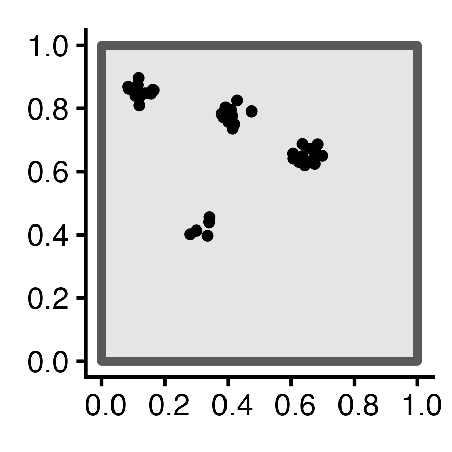

## *Why* Do Events Appear Where They Do? {.smaller .title-12 .inline-90 .nostretch}

```{r}
#| label: sr-plot
#| code-fold: true
#| output: false
#| fig-align: center
#| fig-width: 4
#| fig-height: 4
#| crop: true
set.seed(6809)
N <- 60
r_core <- 0.05
obs_window <- square(1)
### Clustered data
clust_ppp <- rMatClust(
  kappa=6,
  scale=r_core,
  mu=10
)
clust_sf <- clust_ppp |> sf::st_as_sf()
clust_plot <- clust_sf |>
  ggplot() +
  geom_sf(size=2) +
  theme_classic(base_size=18)
ggsave("images/clust_ppp.png", clust_plot, width=3, height=3)
# Intensity fn
clust_intensity <- density(clust_ppp, sigma = 0.1)
png("images/clust_intensity.png")
par(mar=c(0,0,0,2), las=2, oma=c(0,0,0,0), cex=2)
plot(clust_intensity, main=NULL)
contour(clust_intensity, add = TRUE)
dev.off()
### PCF
clust_pcf <- spatstat.explore::pcf(
  clust_ppp, divisor="d",
  r=seq(from=0.00, to=0.50, by=0.01)
)
clust_pcf_plot <- clust_pcf |> ggplot(aes(x=r, y=iso)) +
  geom_hline(yintercept=1, linetype='dashed', linewidth=1) +
  geom_area(color='black', fill=cb_palette[1], alpha=0.75) +
  scale_x_continuous(breaks=seq(from=0.0, to=1.0, by=0.1)) +
  labs(x="Distance", y="Density") +
  theme_classic(base_size=14)
ggsave("images/clust_pcf.png", clust_pcf_plot, width=3, height=3)
```

```{=html}
<table style='width: 100%; table-layout: fixed;'>
<colgroup>
  <col style='width: 32%;' />
  <col style='width: 34%;' />
  <col style='width: 32%;' />
</colgroup>
<thead>
<tr>
  <th>Original Data</th>
  <th>First-Order</th>
  <th>Second-Order</th>
</tr>
</thead>
<tbody>
<tr>
  <td class='tdvc'><span data-qmd="$N = 60$ Events"></span></td>
  <td><span data-qmd="Events modeled **individually**<br>$\implies$ **Intensity function $\lambda(\mathbf{s})$**"></span></td>
  <td><span data-qmd="Events modeled **pairwise** $\implies$ **$K$-function $K(\vec{h})$**"></span></td>
</tr>
<tr>
  <td></td>
  <td class='tdvc'></td>
  <td class='tdvc'></td>
</tr>
</tbody>
</table>
```

## What Do These Functions "Detect"? {.crunch-title .smaller .crunch-img .crunch-quarto-figure .crunch-columns}

:::: {.columns}
::: {.column width="33%"}

```{r}
#| label: sq-point-plot2
#| code-fold: true
#| fig-width: 2.5
#| fig-height: 2.5
sq_base <- 16
sq_psize <- 2.5
obs_window <- square(1)
r0 <- 0.2
sq_df <- tibble::tribble(
  ~x, ~y,
  0.5-r0,0.5-r0,
  0.5+r0,0.5+r0,
  0.5-r0,0.5+r0,
  0.5+r0,0.5-r0
)
sq_sf <- sf::st_as_sf(
  sq_df,
  coords = c("x","y")
)
sq_ppp <- as.ppp(sq_sf, W=obs_window)
sq_ppp |> sf::st_as_sf() |> ggplot() +
  geom_sf(size=sq_psize) +
  theme_classic(base_size=sq_base)
```

:::
::: {.column width="33%"}

```{r}
#| label: sq-intensity-plot2
#| code-fold: true
#| fig-width: 3
#| fig-height: 3
#| crop: true
par(mar=c(0,0,0,2), las=2, oma=c(0,0,1,0))
sq_density <- density(sq_ppp)
plot(sq_density, main=NULL, xaxs='i', yaxs='i')
contour(sq_density, xaxs='i', yaxs='i', add = TRUE)
```

:::
::: {.column width="33%"}

```{r}
#| label: sq-pcf-plot2
#| code-fold: true
#| fig-width: 5
#| fig-height: 4
### PCF
pcf_result <- spatstat.explore::pcf(
  sq_ppp,
  divisor="d",
  r=seq(from=0.00, to=0.8, by=0.01)
)
pcf_result |> ggplot(aes(x=r, y=iso)) +
  geom_hline(yintercept=1, linetype='dashed', linewidth=1.5) +
  geom_area(color='black', fill=cb_palette[1], alpha=0.75) +
  scale_x_continuous(breaks=seq(from=0.0, to=1.0, by=0.1)) +
  theme_classic(base_size=sq_base)
```

:::
::::

<!-- CSR pattern -->

:::: {.columns}
::: {.column width="33%"}

```{r}
#| label: csr-properties-plot2
#| code-fold: true
#| fig-height: 2.5
#| fig-width: 2.5
csr_ppp <- spatstat.random::rpoispp(
  lambda = 60,
  win=obs_window
)
csr_ppp |> sf::st_as_sf() |> ggplot() +
  geom_sf(size=sq_psize) +
  theme_classic(base_size=sq_base)
```

:::
::: {.column width="33%"}

```{r}
#| label: csr-intensity-plot2
#| code-fold: true
#| fig-width: 3
#| fig-height: 3
#| crop: true
par(
  mar=c(0,0,0,2),
  las=2,
  oma=c(0,0,1,0)
)
csr_density <- density(csr_ppp)
plot(csr_density, main=NULL, xaxs="i", yaxs="i")
contour(csr_density, xaxs="i", yaxs="i", add = TRUE, lwd=1.5)
```

:::
::: {.column width="33%"}

```{r}
#| label: csr-pcf-plot2
#| code-fold: true
#| fig-width: 5
#| fig-height: 4
csr_pcf_result <- spatstat.explore::pcf(
  csr_ppp,
  divisor="d",
  r=seq(from=0.00, to=0.8, by=0.01)
)
csr_pcf_result |> ggplot(aes(x=r, y=iso)) +
  geom_hline(yintercept=1, linetype='dashed', linewidth=1.5) +
  geom_area(color='black', fill=cb_palette[1], alpha=0.75) +
  scale_x_continuous(breaks=seq(from=0.0, to=1.0, by=0.1)) +
  theme_classic(base_size=sq_base)
```

:::
::::