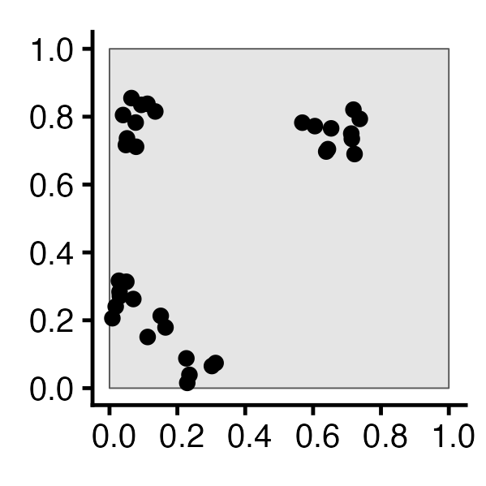
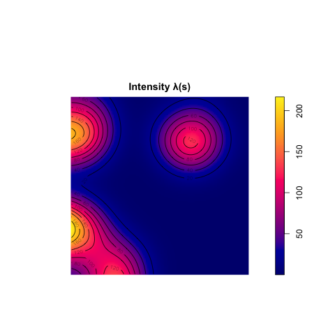
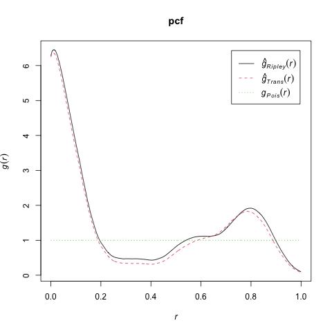

## Chicago Example

::: {.callout-tip title="Census.gov API Keys" icon="false"}

Note: If you want to use US Census data for your project, like the data we're analyzing here, you will probably want to obtain an [API Key](https://api.census.gov/data/key_signup.html){target='_blank'}. Once obtained, you can "register" this key with `tidycensus` via the following line of code:

``` {.r}
tidycensus::census_api_key("<your API key here>", overwrite=TRUE, install=TRUE)
```

:::

---


## [<i class='bi bi-tree-fill'></i>] *Why* Do Events Appear Where They Do? {.smaller .title-10 .inline-90}

```{r}
#| label: intensity-est
#| code-fold: true
#| fig-width: 2
#| fig-height: 2
#| output: false
library(tidyverse)
library(spatstat)
set.seed(6806)
N <- 60
lambda <- 60
r_core <- 0.05
obs_window <- square(1)
# Regularity via Inhibition
# Regularity via Inhibition
reg_sims <- rMaternI(lambda, r=r_core, win=obs_window)
# CSR data
csr_sims <- rpoispp(N, win=obs_window)
### Clustered data
clust_mu <- 10
clust_sims <- rMatClust(kappa=lambda / clust_mu, scale=2*r_core, mu=10, win=obs_window)
# Each cluster consist of 10 points in a disc of radius 0.2
nclust <- function(x0, y0, radius, n) {
    #print(n)
    return(runifdisc(10, radius, centre=c(x0, y0)))
}
cond_clust_sims <- rNeymanScott(kappa=5, expand=0.0, rclust=nclust, radius=2*r_core, n=10)
cond_clust_sf <- cond_clust_sims |> sf::st_as_sf()
pines_plot <- cond_clust_sf |>
  ggplot() +
  geom_sf() +
  theme_classic(base_size=12)
ggsave("images/pines.png", pines_plot)
# density() calls density.ppp() if the argument is a ppp object
den <- density(cond_clust_sims, sigma = 0.1)
#summary(den)
png("images/intensity_plot.png")
plot(den, main = "Intensity λ(s)")
contour(den, add = TRUE) # contour plot
dev.off()
# And Gest / Kest / Lest
# saveRDS(cond_clust_sims, "cond_clust_sims.rds")
pcf_result <- spatstat.explore::pcf.ppp(
  cond_clust_sims,
  divisor="d",
  stoyan=0.25,
  bw=0.05,
  r=seq(from=0.0, to=1.0, by=0.001)
)
png("images/spatstat_pcf.png")
plot(pcf_result, xlim=c(0, 1), main="pcf")
dev.off()
# kest_result <- Kest(cond_clust_sims, rmax=0.5, correction="best")
# lest_result <- center_l_function(cond_clust_sims, rmax=0.5)
# png("images/lest.png")
# plot(lest_result, main="K(h)")
# dev.off()
```

| | First-Order | Second-Order |
|-|-|-|
| | Events considered **individually** $\Rightarrow$ **Intensity function $\lambda(\mathbf{s})$** | Events considered **pairwise** $\Rightarrow$ **Pairwise Correlation Function $\textrm{pcf}(\vec{h})$** |
|  |  |  |

: {tbl-colwidths="[30,36,34]"}
