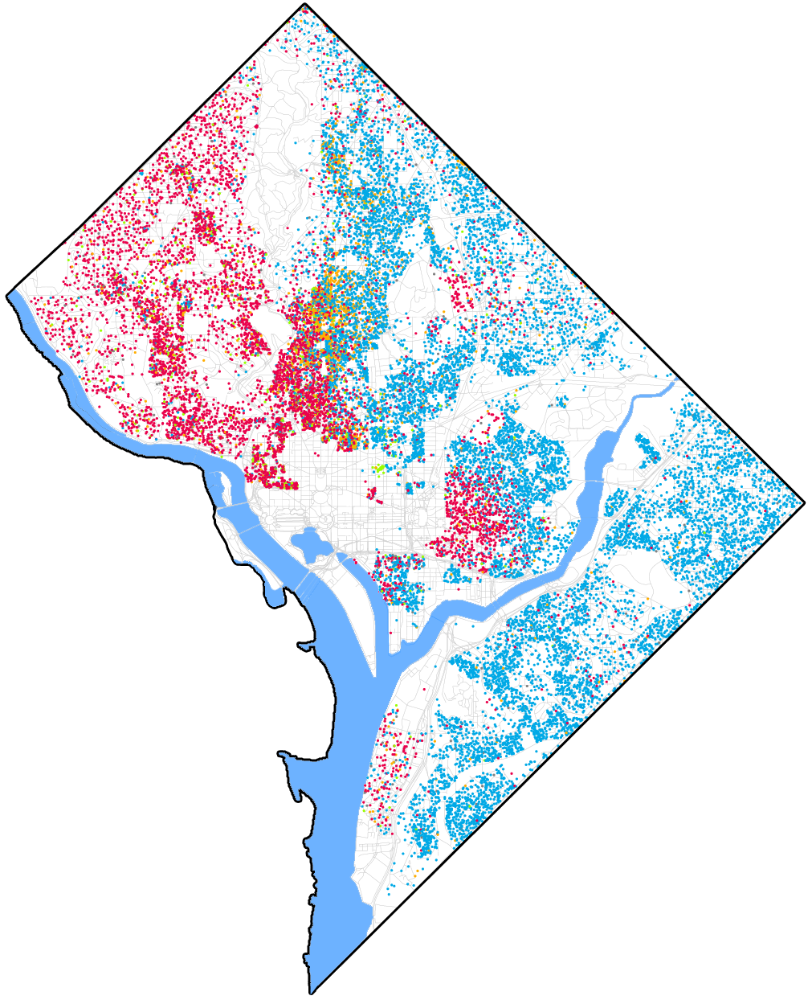
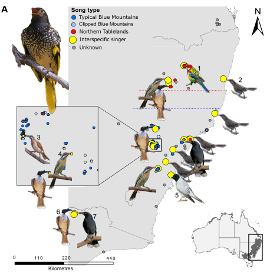
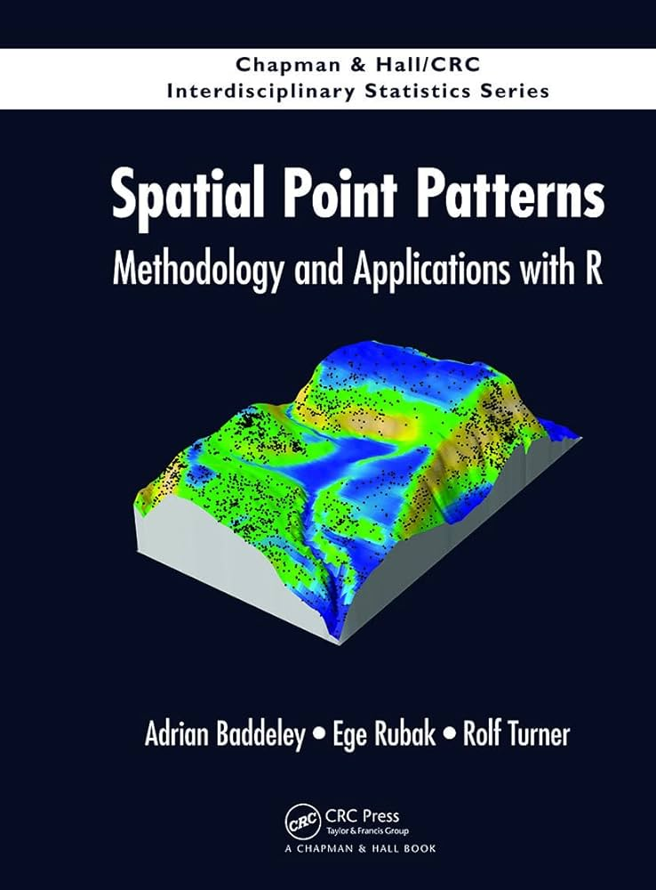
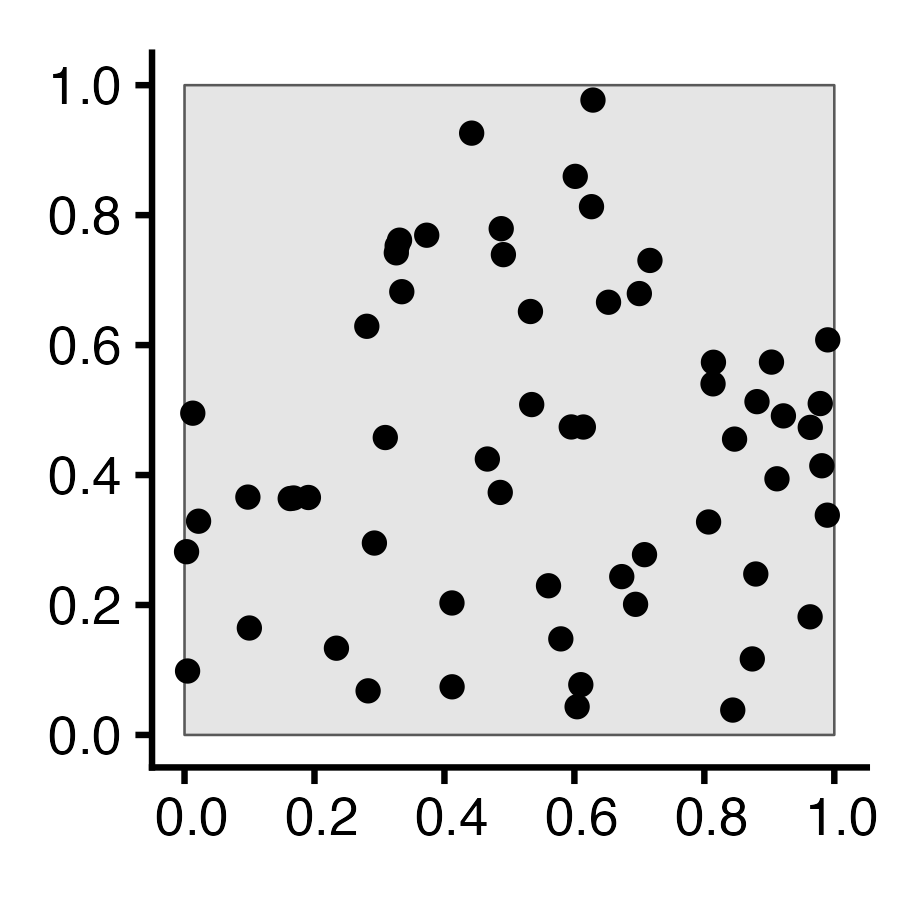
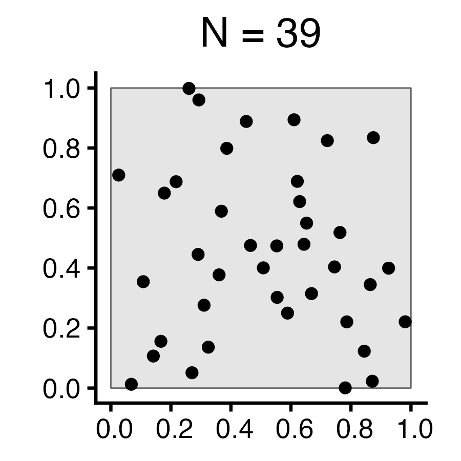
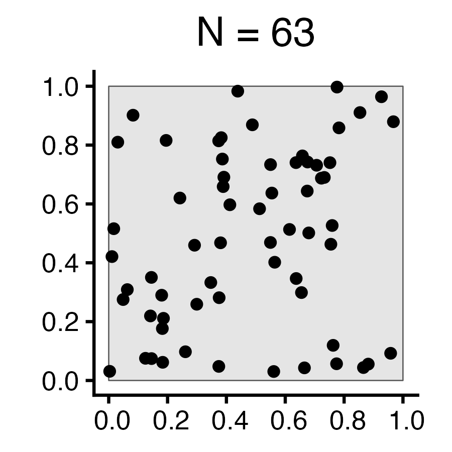
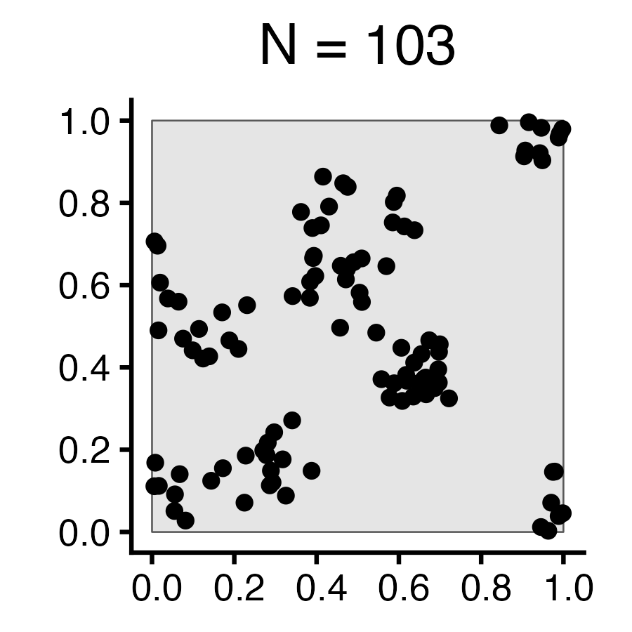
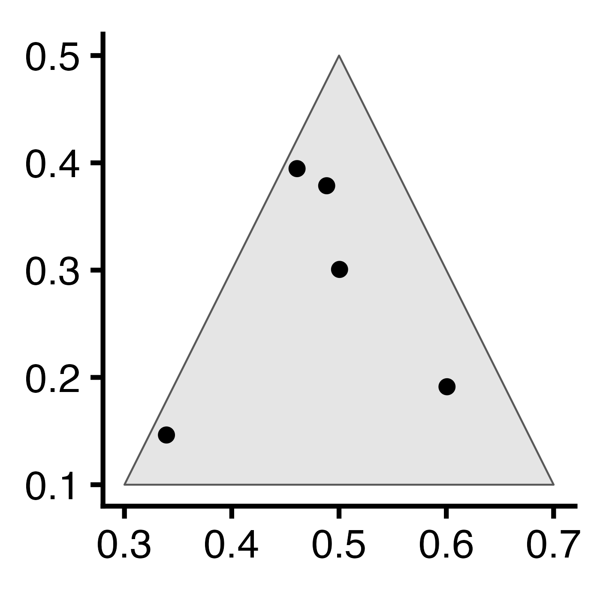
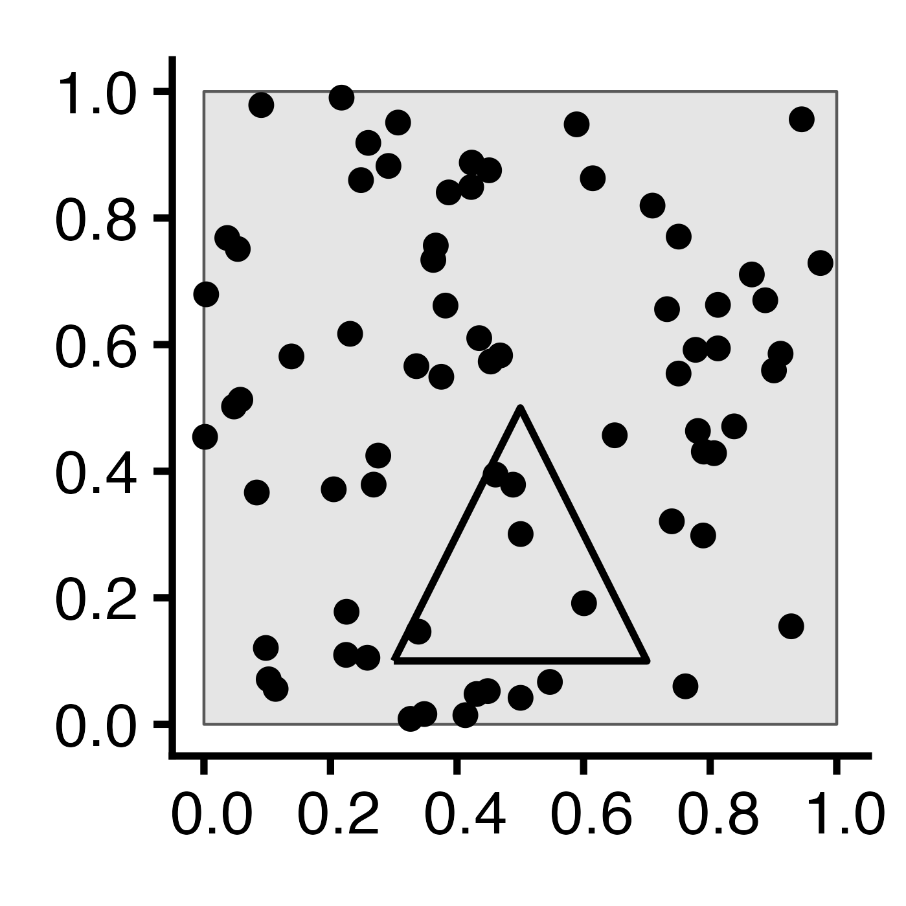
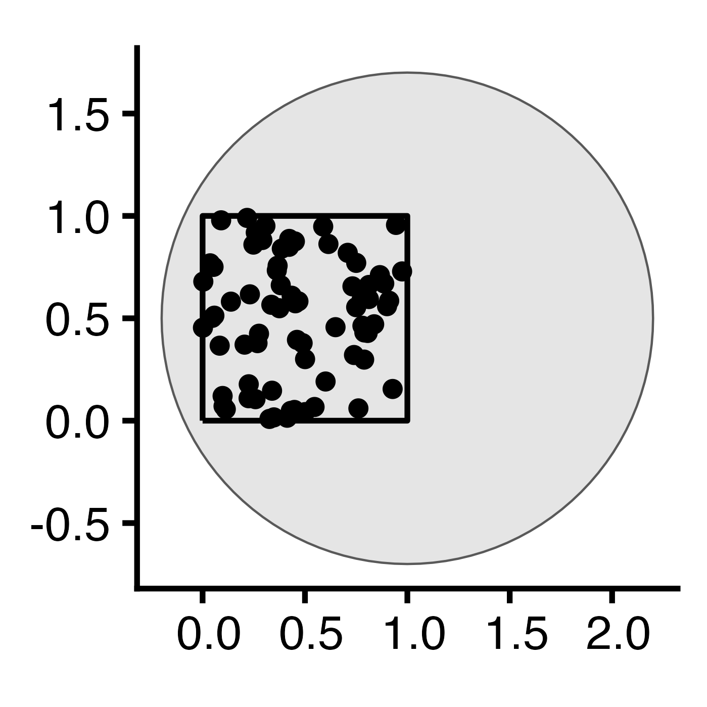

::: {.content-visible unless-format="revealjs"}

<center class='mb-3'>
<a class="h2" href="./slides.html" target="_blank">Open slides in new tab &rarr;</a>
</center>

:::

# Roadmap to the Midterm! {.crunch-title .title-13 .text-95 data-stack-name="Moran's I"}

* This Week (**Oct 21**): Evaluating Hypotheses for **Point Data**
* Next Week (**Oct 28**): Evaluating Hypotheses for **Areal Data**
* In-Class Midterm (**Nov 4**): Basically a "mini-homework" on `sf` &rarr; `ppp` &rarr; spatial hypothesis testing!

::: {.hidden}

```{r}
#| label: r-source-globals
source("../dsan-globals/_globals.r")
set.seed(6805)
library(tidyverse) |> suppressPackageStartupMessages()
library(sf) |> suppressPackageStartupMessages()
library(spatstat) |> suppressPackageStartupMessages()
library(mdthemes) |> suppressPackageStartupMessages()
library(mapview) |> suppressPackageStartupMessages()
library(leaflet) |> suppressPackageStartupMessages()
```

:::

## So... What Do We *Do* With Moran's $I$? {.smaller .crunch-title .title-11 .text-60 .crunch-img-1}

```{=html}
<table>
<colgroup>
<col style="width: 19%;">
<col style="width: 25%;">
<col style="width: 30%;">
<col style="width: 26%;">
</colgroup>
<thead>
<tr>
  <td align="center"></td>
  <td align="center">Doctor</td>
  <td align="center">Midterm Practice</td>
  <td align="center">Midterm</td>
</tr>
</thead>
<tbody>
<tr>
  <td width="19%" class='tdvc'></td>
  <td class='tdvc' width="25%">Your temperature is 40° C</td>
  <td class='tdvc' width="30%"><span data-qmd="Moran's $I$ of Protestant Churches is 0.58"></span></td>
  <td class='tdvc'><span data-qmd="Moran's $I$ of waste dump sites is 0.67"></span></td>
</tr>
<tr>
  <td class='tdvc'></td>
  <td class='tdvc'>One cause could be malaria, 40% likelihood</td>
  <td class='tdvc'>One cause could be urbanization, 40% likelihood</td>
  <td class='tdvc'>One cause could be density of stigmatized group, 60% likelihood</td>
</tr>
<tr>
  <td class='tdvc'></td>
  <td class='tdvc'>One cause could be lupus, 75% likelihood</td>
  <td class='tdvc'>One cause could be distance from Luther, 75% likelihood</td>
  <td class='tdvc'>One cause could be distance from <a href='https://en.wikipedia.org/wiki/United_Nations_Operation_in_C%C3%B4te_d%27Ivoire'>UNOCI HQ</a>, 75% likelihood</td>
</tr>
<tr>
  <td class='tdvc'></td>
  <td class='tdvc'><span data-qmd="I judge lupus as more likely cause, we should [treat it](https://www.mayoclinic.org/diseases-conditions/lupus/diagnosis-treatment/drc-20365790#treatment)"></span></td>
  <td class='tdvc'>I judge distance from Luther as more likely, we should study Luther more</td>
  <td class='tdvc'>I judge distance from UNOCI as more likely; handle in UN not ICC
  </td>
</tr>
</tbody>
</table>
```

## Agenda for Point Patterns: Something "Noteworthy" is Happening if Pattern Unlikely to Arise ~~Randomly~~ Under CSR! {.smaller .title-09 .crunch-title .crunch-p .not-title-slide .crunch-quarto-layout-panel .text-65 .crunch-img}

:::: {layout="[1,1,1]" layout-valign="center"}
::: {#less-clustering}

<center>

**Less** clustering than expected

</center>

:::
::: {#csr-clustering}

<center>

Roughly **expected** amount of clustering under CSR

</center>

:::
::: {#more-clustering}

<center>

**More** clustering than expected

</center>

:::
::::

:::: {layout="[1,1,1]" layout-valign="center"}
::: {.column width="34%"}

](images/new-settlements.webp){.lightbox fig-align="center" width="60%"}

:::
::: {.column width="33%"}

*](images/polygons.png){.lightbox fig-align="center" width="80%"}

:::
::: {.column width="33%"}

{.lightbox fig-align="center" width="90%"}

:::
::::

## ...Or, [Non-Human] Nature Examples {.title-11 .crunch-title .smaller .crunch-p .crunch-quarto-figure .text-60}

:::: {layout="[1,1,1]" layout-valign="center"}
::: {.column width="33%"}

](images/fairy_circles.webp){.lightbox fig-align="center"}

 in Mozambique](images/termite_mounds.jpg){.lightbox fig-align="center"}

:::
::: {.column width="30%"}

](images/leaves.jpg){.lightbox fig-align="center"}

:::
::: {.column width="36%"}

 of Italy; from @morinay_withincolony_2023](images/kestrals.jpg){.lightbox fig-align="center" width="90%"}

{.lightbox fig-align="center" width="200"}

:::
::::

## But, a Challenge...

Typically depends on *context* and/or *level of resolution* and/or *level of analysis*

{fig-align="center"}

## Naïve Clustering {.smaller .smaller-table}

&nbsp;

```{=html}
<table style="width: 100%;">
<colgroup>
  <col style="width: 15%;">
  <col style="width: 16%;">
  <col style="width: 4%;">
  <col style="width: 20%;">
  <col style="width: 5%;">
  <col style="width: 15%;">
  <col style="width: 5%;">
  <col style="width: 20%;">
</colgroup>
<thead>
</thead>
<tbody>
<tr>
    <td class='tdvc'><span data-qmd="**Weeks 8-9**<br>(My labels)"></span></td>
    <td class='tdvc'>Naïve Clustering</td>
    <td class='tdvc'>&rarr;</td>
    <td class='tdvc'><span data-qmd="Point Process **Models**"></span></td>
    <td class='tdvc'>&rarr;</td>
    <td class='tdvc'>Autocorrelation in Point Data</td>
    <td class='tdvc'>&rarr;</td>
    <td class='tdvc'>Autocorrelation in Lattice Data</td>
</tr>
<tr>
    <td class='tdvc'><span data-qmd="**@waller_applied_2004**"></span></td>
    <td class='tdvc'><span data-qmd="*(A bunch of stuff we already learned)*"></span></td>
    <td class='tdvc'>&rarr;</td>
    <td class='tdvc' style='border: 3px solid black;'>Ch 5: Analysis of Spatial Point Patterns</td>
    <td class='tdvc'>&rarr;</td>
    <td class='tdvc' style='border: 3px solid black;'>Ch 6: Point Data (Cases and Controls)</td>
    <td class='tdvc'>&rarr;</td>
    <td class='tdvc' style='border: 3px solid black;'><span data-qmd="Ch 7: Regional Count Data<br>*(First mention of autocorrelation on pg. 227)*"></span></td>
</tr>
<tr>
    <td class='tdvc'><span data-qmd="**@schabenberger_statistical_2004**"></span></td>
    <td class='tdvc' style='border: 3px solid black;'>Ch 1 (pg. 14): Autocorrelation</td>
    <td class='tdvc'>&rarr;</td>
    <td class='tdvc' align='center' colspan="5"><span data-qmd="*(A bunch of more complicated stuff we'll learn at the end)*"></span></td>
</tr>
</tbody>
</table>
```

## Why "Naïve"? {.crunch-title .title-11 .crunch-ul}

* **Regional data**: easiest way to visualize simple measures of **clustering** via **spatial autocorrelation**
* So, we develop **intuitions** for measures like Moran's $I$ by looking at **lattice** data, but...
* Naïve because **we're not modeling the lattice regions (cells) themselves!**
* Non-naïve clustering: Modeling **clusters** but also **what process led to their formation**! Which brings us to...

# ...Point Process Models! {.crunch-title .title-09 .not-title-slide data-stack-name="Point Process Models"}

:::: {.columns}
::: {.column width="55%"}

* Our New Library: `spatstat`!
* Homepage: [spatstat.org](https://spatstat.org/){target='_blank'}
* GitHub: [github.com/spatstat](https://github.com/spatstat){target='_blank'}
* Book: @baddeley_spatial_2015 <br> \[[Companion website](http://book.spatstat.org/){target='_blank'}\]
* PDF: [here](https://www.dropbox.com/scl/fi/egw826hopf6q53ll071n1/Baddeley-Adrian_-Rubak-Ege_-Turner-Rolf-Spatial-point-patterns.pdf?rlkey=y1n4smru4sj43sxzu4x54p5a9&dl=1)

:::
::: {.column width="45%"}

{fig-align="center" width="75%"}

:::
::::

## Spatial Randomness {.smaller .smaller-table .crunch-title .crunch-img .text-65}

```{r}
#| label: sr-plot
#| fig-align: center
#| code-fold: true
#| output: false
library(tidyverse)
library(spatstat)
set.seed(6805)
N <- 60
r_core <- 0.05
obs_window <- square(1)
# Regularity via Inhibition
#reg_sims <- rMaternI(N, r=r_core, win=obs_window)
cond_reg_sims <- rSSI(r=r_core, N)
# CSR data
#csr_sims <- rpoispp(N, win=obs_window)
cond_sr_sims <- rpoint(N, win=obs_window)
### Clustered data
#clust_sims <- rMatClust(kappa=6, r=2.5*r_core, mu=10, win=obs_window)
#clust_sims <- rMatClust(mu=5, kappa=1, scale=0.1, win=obs_window, n.cond=N, w.cond=obs_window)
#clust_sims <- rclusterBKBC(clusters="MatClust", kappa=10, mu=10, scale=0.05, verbose=FALSE)
# Each cluster consist of 10 points in a disc of radius 0.2
nclust <- function(x0, y0, radius, n) {
    #print(n)
    return(runifdisc(10, radius, centre=c(x0, y0)))
}
cond_clust_sims <- rNeymanScott(kappa=5, expand=0.0, rclust=nclust, radius=2*r_core, n=10)
# And PLOT
plot_w <- 400
plot_h <- 400
plot_scale <- 2.25
cond_reg_plot <- cond_reg_sims |> sf::st_as_sf() |>
  ggplot() +
  geom_sf() +
  dsan_theme() +
  transparent_bg()
ggsave("images/cond_reg.png", cond_reg_plot, width=plot_w, height=plot_h, units="px", scale=plot_scale)
cond_sr_plot <- cond_sr_sims |> sf::st_as_sf() |>
  ggplot() +
  geom_sf() +
  dsan_theme() +
  transparent_bg()
ggsave("images/cond_sr.png", cond_sr_plot, width=plot_w, height=plot_h, units="px", scale=plot_scale)
cond_clust_plot <- cond_clust_sims |> sf::st_as_sf() |>
  ggplot() +
  geom_sf() +
  dsan_theme() +
  transparent_bg()
ggsave("images/cond_clust.png", cond_clust_plot, width=plot_w, height=plot_h, units="px", scale=plot_scale)
```

```{=html}
<table style="width: 100%;">
<colgroup>
  <col style="width: 20%;">
  <col style="width: 25%;">
  <col style="width: 2%;">
  <col style="width: 25%;">
  <col style="width: 2%;">
  <col style="width: 25%;">
</colgroup>
<thead>
<tr>
    <th><span data-qmd="Autocorrelation"></span></th>
    <th align="center" class='tdvc'><span data-qmd="$I = -1$"></span></th>
    <th align="center" class='tdvc'>&larr;</th>
    <th align="center" class='tdvc'><span data-qmd="$I = 0$"></span></th>
    <th align="center" class='tdvc'>&rarr;</th>
    <th align="center" class='tdvc'><span data-qmd="$I = 1$"></span></th>
</tr>
</thead>
<tbody>
<tr>
    <td><span data-qmd="**Description**"></span></td>
    <td align="center"><span data-qmd="*Negative* Autocorr"></span></td>
    <td></td>
    <td align="center"><span data-qmd="*No* Autocorr"></span></td>
    <td></td>
    <td align="center"><span data-qmd="*Positive* Autocorr"></span></td>
</tr>
<tr>
    <td><span data-qmd="**Event at $\mathbf{s} = (x,y)$ Implies**"></span></td>
    <td align="center"><span data-qmd="*Less* likely to find another point nearby"></span></td>
    <td></td>
    <td align="center"><span data-qmd="No information about nearby points"></span></td>
    <td></td>
    <td align="center"><span data-qmd="*More* likely to find another point nearby"></span></td>
</tr>
<tr>
    <td><span data-qmd="**Resulting Pattern**"></span></td>
    <td align="center">Regularity</td>
    <td></td>
    <td align="center">Reg/Clustered Mix</td>
    <td></td>
    <td align="center">Clustering</td>
</tr>
<tr>
    <td><span data-qmd="**Process(es) Which Could Produce Pattern**"></span></td>
    <td align="left"><span data-qmd="**1st Order**: Random within even-spaced grid<br>**2nd Order**: Competition"></span></td>
    <td></td>
    <td align="center"><span data-qmd="**1st Order**: i.i.d. points<br>**2nd Order**: i.i.d. distances"></span></td>
    <td></td>
    <td align="center"><span data-qmd="**1st Order**: Tasty food at clust centers<br>**2nd Order**: Cooperation"></span></td>
</tr>
<tr>
    <td><span style="border: 2px solid red; padding-left: 3px !important; padding-right: 3px !important;"><span data-qmd="**Fixed $N$**"></span></span></td>
    <td align="center">60</td>
    <td></td>
    <td align="center">60</td>
    <td></td>
    <td align="center">60</td>
</tr>
<tr>
    <td style="vertical-align: top; padding-top: 8px;"><span data-qmd="*Problem with fixed $N$: Learning there are $n_1$ points in region $R_1$ $\Rightarrow$ there are $N - n_1$ points outside $R_1$*"></span></td>
    <td align="center"></img></td>
    <td></td>
    <td align="center"></img></td>
    <td></td>
    <td align="center"></img></td>
</tr>
</tbody>
</table>
```

## *Complete* Spatial Randomness (CSR) {.smaller .smaller-table .crunch-title .crunch-img .text-65}

```{r}
#| label: csr-plot
#| fig-align: center
#| code-fold: true
#| output: false
library(tidyverse)
library(spatstat)
set.seed(6807)
lambda <- 60
r_core <- 0.05
obs_window <- square(1)
# Regularity via Inhibition
# Regularity via Inhibition
reg_sims <- rMaternI(lambda, r=r_core, win=obs_window)
# CSR data
csr_sims <- rpoispp(N, win=obs_window)
### Clustered data
clust_mu <- 10
clust_sims <- rMatClust(kappa=lambda / clust_mu, scale=2*r_core, mu=10, win=obs_window)
# And PLOT
plot_w <- 400
plot_h <- 400
plot_scale <- 2.25
reg_plot <- reg_sims |> sf::st_as_sf() |>
  ggplot() +
  geom_sf() +
  labs(title=paste0("N = ",reg_sims$n)) +
  dsan_theme() +
  transparent_bg()
ggsave("images/reg.png", reg_plot, width=plot_w, height=plot_h, units="px", scale=plot_scale)
csr_plot <- csr_sims |> sf::st_as_sf() |>
  ggplot() +
  geom_sf() +
  labs(title=paste0("N = ",csr_sims$n)) +
  dsan_theme() +
  transparent_bg()
ggsave("images/csr.png", csr_plot, width=plot_w, height=plot_h, units="px", scale=plot_scale)
clust_plot <- clust_sims |> sf::st_as_sf() |>
  ggplot() +
  geom_sf() +
  labs(title=paste0("N = ",clust_sims$n)) +
  dsan_theme() +
  transparent_bg()
ggsave("images/clust.png", clust_plot, width=plot_w, height=plot_h, units="px", scale=plot_scale)
```

```{=html}
<table style="width: 100%;">
<colgroup>
  <col style="width: 20%;">
  <col style="width: 25%;">
  <col style="width: 2%;">
  <col style="width: 25%;">
  <col style="width: 2%;">
  <col style="width: 25%;">
</colgroup>
<thead>
<tr>
    <th><span data-qmd="Autocorrelation"></span></th>
    <th align="center" class='tdvc'><span data-qmd="$I = -1$"></span></th>
    <th align="center" class='tdvc'>&larr;</th>
    <th align="center" class='tdvc'><span data-qmd="$I = 0$"></span></th>
    <th align="center" class='tdvc'>&rarr;</th>
    <th align="center" class='tdvc'><span data-qmd="$I = 1$"></span></th>
</tr>
</thead>
<tbody>
<tr>
    <td><span data-qmd="**Description**"></span></td>
    <td align="center"><span data-qmd="*Negative* Autocorr"></span></td>
    <td></td>
    <td align="center"><span data-qmd="*No* Autocorr"></span></td>
    <td></td>
    <td align="center"><span data-qmd="*Positive* Autocorr"></span></td>
</tr>
<tr>
    <td><span data-qmd="**Event at $\mathbf{s} = (x,y)$ Implies**"></span></td>
    <td align="center"><span data-qmd="*Less* likely to find another point nearby"></span></td>
    <td></td>
    <td align="center"><span data-qmd="No information about nearby points"></span></td>
    <td></td>
    <td align="center"><span data-qmd="*More* likely to find another point nearby"></span></td>
</tr>
<tr>
    <td><span data-qmd="**Resulting Pattern**"></span></td>
    <td align="center">Regularity</td>
    <td></td>
    <td align="center">Reg/Clustered Mix</td>
    <td></td>
    <td align="center">Clustering</td>
</tr>
<tr>
    <td><span data-qmd="**Process(es) Which Could Produce Pattern**"></span></td>
    <td align="left"><span data-qmd="**1st Order**: Random within even-spaced grid<br>**2nd Order**: Competition"></span></td>
    <td></td>
    <td align="center"><span data-qmd="**1st Order**: i.i.d. points<br>**2nd Order**: i.i.d. distances"></span></td>
    <td></td>
    <td align="center"><span data-qmd="**1st Order**: Tasty food at clust centers<br>**2nd Order**: Cooperation"></span></td>
</tr>
<tr>
    <td><span data-qmd="**Fixed Intensity $\lambda$**"></span></td>
    <td align="center">60</td>
    <td></td>
    <td align="center">60</td>
    <td></td>
    <td align="center">60</td>
</tr>
<tr>
    <td class='tdvt'><span style="border: 2px solid red; padding-left: 3px !important; padding-right: 3px !important;"><span data-qmd="**Random $N$**"></span></span></td>
    <td align="center"></img></td>
    <td></td>
    <td align="center"></img></td>
    <td></td>
    <td align="center"></img></td>
</tr>
</tbody>
</table>
```

## Caveat 1: Measures are *Relative* to Window of Observation {.smaller .title-12}

**Same data** can be spatially **random** in one window, **clustered** or **regular** in others!

```{r}
#| label: obs-windows
#| code-fold: true
#| output: false
N <- 60
obs_window <- square(1)
window_scale <- 3.5
csr_sims_square <- rpoispp(N, win=obs_window)
# Triangular window
obs_window_tri <- st_sfc(st_polygon(list(
    matrix(c(0.3,0.1,0.7,0.1,0.5,0.5,0.3,0.1), byrow=TRUE, nrow=4)
)))
obs_window_geom <- st_sfc(st_linestring(
    matrix(c(0,0,1,0,1,1,0,1,0,0), byrow=TRUE, nrow=5)
))
csr_sims_tri <- ppp(csr_sims_square$x, csr_sims_square$y, window=as.owin(obs_window_tri))
tri_plot <- csr_sims_tri |> sf::st_as_sf() |>
  ggplot() +
  geom_sf() +
  dsan_theme("quarter") +
  transparent_bg()
ggsave("images/window_tri.png", tri_plot, width=plot_w, height=plot_h, units="px", scale=window_scale)
# Square window
square_plot <- csr_sims_square |> sf::st_as_sf() |>
  ggplot() +
  geom_sf() +
  geom_sf(data=obs_window_tri |> sf::st_boundary()) +
  dsan_theme("quarter") +
  transparent_bg()
ggsave("images/window_square.png", square_plot, width=plot_w, height=plot_h, units="px", scale=window_scale)
# Circular window
obs_window_disc <- st_sfc(st_point(c(1, 0.5))) |> st_buffer(1.2)
csr_sims_circ <- ppp(csr_sims_square$x, csr_sims_square$y, window=as.owin(obs_window_disc))
circ_plot <- csr_sims_circ |> sf::st_as_sf() |>
  ggplot() +
  geom_sf() +
  geom_sf(data=obs_window_geom) +
  dsan_theme("quarter") +
  transparent_bg()
ggsave("images/window_circ.png", circ_plot, width=plot_w, height=plot_h, units="px", scale=window_scale)
```

| Regular | CSR | Clustered |
|:-:|:-:|:-:|
| {fig-align="center"} | {fig-align="center"} | {fig-align="center"} |

## Caveat 2: Summary Statistics Like $I$ are Not *Models*! {.title-10}

* Moran's $I$ is to **GISers** what a thermometer is to **doctors**
* Measures **symptoms**; many possible underlying **causes!**
* Need to ask *why* autocorrelation seems to be present!

## The Tree-Grid Mystery {.crunch-title .text-90 .crunch-ul .crunch-p}

You've been hired as an archaeologist -- congratulations! Your job: determine whether arrangement of **trees** formed:

* **Naturally**, via a process of **resource competition**, or
* **Artificially**, via an ancient civilization planting in a **grid**...

```{r, dev.args = list(bg = 'transparent')}
#| label: tree-mystery
#| echo: false
#| code-fold: true
#| fig-align: center
square_sf <- sf::st_as_sf(spatstat.geom::square(1))
grid_sf <- sf::st_as_sf(sf::st_make_grid(square_sf))
grid_buffer_sf <- grid_sf |> sf::st_buffer(dist=-0.01, singleSide = TRUE)
grid_points <- sf::st_sample(grid_buffer_sf, size=rep(1,100))
grid_ppp <- as.ppp(grid_points, W=spatstat.geom::square(1))
grid_ppp |> sf::st_as_sf() |> ggplot() +
  geom_sf() +
  theme_classic(base_size=24) +
  transparent_bg()
```

## Two Possible Histories... {.crunch-title .inline-90 .smaller .crunch-img .crunch-quarto-figure}

<center>
Hypothesis $\mathcal{H}_{\textsf{Art}}$: Artificial Formation
</center>

:::: {.columns}
::: {.column width="33%"}

```{r, dev.args = list(bg = 'transparent')}
#| label: artificial-grid
#| code-fold: true
#| code-summary: "Code (Step 1: Grid Creation)"
#| fig-width: 7
ha_base <- 28
square_sf <- sf::st_as_sf(spatstat.geom::square(1))
grid_sf <- sf::st_as_sf(sf::st_make_grid(square_sf))
grid_buffer_sf <- grid_sf |> sf::st_buffer(dist=-0.01, singleSide = TRUE)
grid_buffer_sf |> ggplot() +
  geom_sf() +
  theme_classic(base_size=ha_base) +
  transparent_bg()
```

:::
::: {.column width="33%"}

```{r, dev.args = list(bg = 'transparent')}
#| label: artificial-grid-points
#| code-fold: true
#| code-summary: "Code (Step 2: Point Generation)"
#| fig-width: 7
grid_points <- sf::st_sample(grid_buffer_sf, size=rep(1,100))
grid_buffer_sf |> ggplot(aes(shape='Cell')) +
  geom_sf() +
  geom_sf(data=grid_points) +
  scale_shape_manual("Shape", values=c('Cell'=19)) +
  theme_classic(base_size=ha_base) +
  theme(
    legend.title = element_blank(),
    # legend.text = element_text(size=18)
  ) +
    transparent_bg()
```

:::
::: {.column width="33%"}

```{r, dev.args = list(bg = 'transparent')}
#| label: artificial-grid-result
#| code-fold: true
#| code-summary: "Code (Step 3: Observed Result)"
#| fig-width: 7
grid_ppp <- as.ppp(grid_points, W=spatstat.geom::square(1))
grid_ppp |> sf::st_as_sf() |> ggplot() +
  geom_sf() +
  theme_classic(base_size=ha_base) +
  transparent_bg()
```

:::
::::

<center>
Hypothesis $\mathcal{H}_{\textsf{Nat}}$: Natural Formation
</center>

:::: {.columns}
::: {.column width="33%"}

```{r, dev.args = list(bg = 'transparent')}
#| label: gen-trees
#| code-fold: true
#| code-summary: "Code (Step 1: Tree Generation)"
#| fig-width: 7
hn_base <- 28
r <- 0.05
pois_ppp <- rpoispp(150)
pois_sf <- pois_ppp |> sf::st_as_sf()
pois_sf |> ggplot() +
  geom_sf() +
  theme_classic(base_size=hn_base) +
  transparent_bg()
```

:::
::: {.column width="34%"}

```{r, dev.args = list(bg = 'transparent')}
#| label: kill-trees
#| code-fold: true
#| code-summary: "Code (Step 2: Competition)"
#| fig-width: 7
#| fig-align: center
age <- runif(npoints(pois_ppp))
pair_dists <- pairdist(pois_ppp)
close <- (pair_dists < r)
later <- outer(age, age, ">")
killed <- apply(close & later, 1, any)
killed_ppp <- pois_ppp[killed]
alive_ppp <- pois_ppp[!killed]
pois_window_sf <- pois_ppp |> sf::st_as_sf() |> filter(label=="window")
pois_killed_sf <- killed_ppp |> sf::st_as_sf() |> filter(label=="point")
pois_alive_sf <- alive_ppp |> sf::st_as_sf() |> filter(label=="point")
alive_buff_sf <- pois_alive_sf |> sf::st_buffer(r) |> sf::st_union() |> sf::st_intersection(pois_window_sf)
ggplot() +
  geom_sf(data=pois_window_sf) +
  geom_sf(data=alive_buff_sf, aes(color='Inhibition', shape='Inhibition'), linetype='dashed') +
  geom_sf(data=pois_killed_sf, aes(color='Dead', shape='Dead'), size=2, stroke=2) +
  geom_sf(data=pois_alive_sf, aes(color='Alive', shape='Alive'), size=1, stroke=1) +
  scale_shape_manual(name=NULL, values=c("Alive"=19, "Dead"=4, 'Inhibition'=21), labels=c("Alive", "Dead", "Inhibition")) +
  scale_color_manual(name=NULL, values=c("Alive"="black", "Dead"=cb_palette[1], "Inhibition"="black"), labels=c("Alive", "Dead", "Inhibition")) +
  guides(shape=guide_legend(override.aes=list(fill = "white"))) +
  theme_classic(base_size = hn_base) +
  theme(plot.margin = unit(c(0,0,0,0), "cm")) +
  transparent_bg()
```

:::
::: {.column width="32%"}

```{r, dev.args = list(bg = 'transparent')}
#| label: post-tree-killing
#| code-fold: true
#| code-summary: "Code (Step 3: Observed Result)"
#| fig-width: 7
alive_ppp |> sf::st_as_sf() |> ggplot() +
  geom_sf() +
  theme_classic(base_size=hn_base) +
  transparent_bg()
```

:::
::::

# What Tools Do We Have for Distinguishing Between These Cases? {data-stack-name="First/Second Moments"}

* **"First-Order"** measures vs. **"Second-Order"** measures

## *Why* Do Events Appear Where They Do? {.smaller .title-12 .inline-95 .nostretch .text-60}

```{r, dev.args = list(bg = 'transparent')}
#| label: sr-plot2
#| code-fold: true
#| output: false
#| fig-align: center
#| fig-width: 4
#| fig-height: 4
#| crop: true
library(tidyverse)
library(spatstat)
set.seed(6809)
N <- 60
r_core <- 0.05
obs_window <- square(1)
### Clustered data
clust_ppp <- rMatClust(
  kappa=6,
  scale=r_core,
  mu=10
)
clust_sf <- clust_ppp |> sf::st_as_sf()
clust_plot <- clust_sf |>
  ggplot() +
  geom_sf(size=2) +
  theme_classic(base_size=18) +
  transparent_bg()
ggsave("images/clust_ppp.png", clust_plot, width=3, height=3)
# Intensity fn
clust_intensity <- density(clust_ppp, sigma = 0.1)
png("images/clust_intensity.png")
par(mar=c(1.5,0,0,2), las=2, oma=c(0,0,0,0), cex=2, bg=NA)
plot(clust_intensity, main=NULL)
contour(clust_intensity, add = TRUE)
dev.off()
### PCF
clust_pcf <- spatstat.explore::pcf(
  clust_ppp, divisor="d",
  r=seq(from=0.00, to=0.50, by=0.01)
)
clust_pcf_plot <- clust_pcf |> ggplot(aes(x=r, y=iso)) +
  geom_hline(yintercept=1, linetype='dashed', linewidth=1) +
  geom_area(color='black', fill=cb_palette[1], alpha=0.75) +
  scale_x_continuous(breaks=seq(from=0.0, to=1.0, by=0.1)) +
  labs(x="Distance", y="Density") +
  theme_classic(base_size=14) +
  transparent_bg()
ggsave("images/clust_pcf.png", clust_pcf_plot, width=3, height=3)
```

```{=html}
<table style='width: 100%; table-layout: fixed;'>
<colgroup>
  <col style='width: 31%;' />
  <col style='width: 33%;' />
  <col style='width: 36%;' />
</colgroup>
<thead>
<tr>
  <th align="center">Original Data</th>
  <th>First-Order</th>
  <th>Second-Order</th>
</tr>
</thead>
<tbody>
<tr>
  <td class='tdvc' align="center"><span data-qmd="$N = 60$ Events"></span></td>
  <td class='tdvc'><span data-qmd="Events modeled **individually**<br>$\Rightarrow$ **Intensity Function $\lambda(\mathbf{s})$**"></span></td>
  <td><span data-qmd="Events modeled **pairwise** $\Rightarrow$ **Pairwise-Corr Function** $\textrm{pcf}(\vec{h})$"></span></td>
</tr>
<tr>
  <td></td>
  <td class='tdvc'></td>
  <td class='tdvc'></td>
</tr>
</tbody>
</table>
```

## What Do These Functions "Detect"? {.crunch-title .smaller .crunch-img .crunch-quarto-figure .crunch-columns .title-12}

:::: {.columns}
::: {.column width="33%"}

```{r, dev.args = list(bg = 'transparent')}
#| label: sq-point-plot
#| code-fold: true
#| fig-width: 2.75
#| fig-height: 2.75
#| code-summary: "Code (Fixed Points)"
sq_base <- 16
sq_psize <- 2.5
obs_window <- square(1)
r0 <- 0.2
sq_df <- tibble::tribble(
  ~x, ~y,
  0.5-r0,0.5-r0,
  0.5+r0,0.5+r0,
  0.5-r0,0.5+r0,
  0.5+r0,0.5-r0
)
sq_sf <- sf::st_as_sf(
  sq_df,
  coords = c("x","y")
)
sq_ppp <- as.ppp(sq_sf, W=obs_window)
sq_ppp |> sf::st_as_sf() |> ggplot() +
  geom_sf(size=sq_psize) +
  theme_classic(base_size=sq_base) +
  transparent_bg()
```

:::
::: {.column .summary-mb width="33%"}

```{r, dev.args = list(bg = 'transparent')}
#| label: sq-intensity-plot
#| code-fold: true
#| fig-width: 3
#| fig-height: 2.5
#| crop: true
par(
  mar=c(0,0,1,2),
  # mai=c(0,0,0.1,0),
  las=2,
  oma=c(0,0,1,0)
)
sq_density <- density(sq_ppp)
plot(sq_density, main=NULL, xaxs='i', yaxs='i', bg=NA)
contour(sq_density, xaxs='i', yaxs='i', add = TRUE)
```

:::
::: {.column width="33%"}

```{r, dev.args = list(bg = 'transparent')}
#| label: sq-pcf-plot
#| code-fold: true
#| fig-width: 5
#| fig-height: 4
### PCF
pcf_result <- spatstat.explore::pcf(
  sq_ppp,
  divisor="d",
  r=seq(from=0.00, to=0.8, by=0.01)
)
pcf_result |> ggplot(aes(x=r, y=iso)) +
  geom_hline(yintercept=1, linetype='dashed', linewidth=1.5) +
  geom_area(color='black', fill=cb_palette[1], alpha=0.75) +
  scale_x_continuous(breaks=seq(from=0.0, to=1.0, by=0.1)) +
  theme_classic(base_size=sq_base) +
  transparent_bg()
```

:::
::::

<!-- CSR pattern -->

:::: {.columns}
::: {.column width="33%"}

```{r, dev.args = list(bg = 'transparent')}
#| label: csr-properties-plot
#| code-fold: true
#| fig-height: 2.75
#| fig-width: 2.75
#| code-summary: "Code (CSR Points)"
csr_ppp <- spatstat.random::rpoispp(
  lambda = 60,
  win=obs_window
)
csr_ppp |> sf::st_as_sf() |> ggplot() +
  geom_sf(size=sq_psize) +
  theme_classic(base_size=sq_base) +
  transparent_bg()
```

:::
::: {.column .summary-mb width="33%"}

```{r, dev.args = list(bg = 'transparent')}
#| label: csr-intensity-plot
#| code-fold: true
#| fig-width: 3
#| fig-height: 2.5
#| crop: true
par(
  mar=c(0,0,1,2),
  las=2,
  oma=c(0,0,1,0)
)
csr_density <- density(csr_ppp)
plot(csr_density, main=NULL, xaxs="i", yaxs="i", bg=NA)
contour(csr_density, xaxs="i", yaxs="i", add = TRUE, lwd=1.5)
```

:::
::: {.column width="33%"}

```{r, dev.args = list(bg = 'transparent')}
#| label: csr-pcf-plot
#| code-fold: true
#| fig-width: 5
#| fig-height: 4
csr_pcf_result <- spatstat.explore::pcf(
  csr_ppp,
  divisor="d",
  r=seq(from=0.00, to=0.8, by=0.01)
)
csr_pcf_result |> ggplot(aes(x=r, y=iso)) +
  geom_hline(yintercept=1, linetype='dashed', linewidth=1.5) +
  geom_area(color='black', fill=cb_palette[1], alpha=0.75) +
  scale_x_continuous(breaks=seq(from=0.0, to=1.0, by=0.1)) +
  theme_classic(base_size=sq_base) +
  transparent_bg()
```

:::
::::

# A Menagerie of Models {.title-12 .not-title-slide data-stack-name="Visualizing Models"}

<center>

[Open Interactive (WebR) Version](https://jjacobs.me/gis-webr)

</center>

## Poisson Point Processes (CSR) {.crunch-title .crunch-img .crunch-ul .inline-90 .crunch-p}

``` {.r}
spatstat.random::rpoispp(lambda, win)
```

* <i class='bi bi-1-circle'></i> $N \sim \text{Pois}(\lambda)$
* <i class='bi bi-2-circle'></i> For $i \in \{1, \ldots, N\}$:
  * Generate $X_i, Y_i \sim \mathcal{U}(\texttt{win})$

```{r, dev.args = list(bg = 'transparent')}
#| label: pois-ppp-sims
#| code-fold: true
#| fig-align: center
#| crop: true
sim_base <- 20
sim_psize <- 2
sim_xticks <- seq(from=0.0, to=1.0, by=0.2)
sim_yticks <- seq(from=0.0, to=1.0, by=0.2)
gen_pois_df <- function(num_sims=1) {
  pois_sims <- spatstat.random::rpoispp(
    lambda = 60, nsim=num_sims
  )
  return(tibble::as_tibble(pois_sims))
}
#pois_dfs <- gen_pois_df()
#pois_dfs |> head()
pois_sims <- spatstat.random::rpoispp(
  lambda = 60, nsim=3
)
to_sim_df <- function(cur_sim, sim_name) {
  cur_df <- tibble::as_tibble(cur_sim) |> mutate(sim=sim_name)
  return(cur_df)
}
combined_df <- imap(.x=pois_sims, .f=to_sim_df) |> bind_rows()
combined_df |> ggplot(aes(x=x, y=y)) +
  geom_point(size=sim_psize) +
  facet_wrap(vars(sim)) +
  coord_equal() +
  theme_classic(base_size=sim_base) +
  theme(panel.spacing.x = unit(2, "lines")) +
  scale_x_continuous(breaks=sim_xticks) +
  scale_y_continuous(breaks=sim_yticks) +
  transparent_bg()
```

## Simple Sequential Inhibition (SSI) {.smaller .crunch-title .title-11 .inline-90 .code-90 .crunch-img .crunch-quarto-figure .crunch-ul .crunch-p}

``` {.r}
spatstat.random::rSSI(r, n=Inf, giveup=1000, win)
```

* $\mathbf{S} = \varnothing$
* While not `done`:
  * <i class='bi bi-1-circle'></i> Generate $\mathbf{E} = (X, Y) \sim \mathcal{U}(\texttt{win})$
  * <i class='bi bi-2-circle'></i> Check if $\mathbf{E}$ within `r` units of any existing point in $\mathbf{S}$
    * If it is, **throw $\mathbf{E}$ away**. Otherwise, **add $\mathbf{E}$ to $\mathbf{S}$**
  * <i class='bi bi-3-circle'></i> `done=TRUE` if $\mathbf{S}$ has `n` points OR has been the same for `giveup` steps

```{r, dev.args = list(bg = 'transparent')}
#| label: ssi-sims
#| code-fold: true
#| fig-align: center
#| warning: false
#| crop: true
capture.output(ssi_sims <- spatstat.random::rSSI(
  r = 0.05, n=60, nsim=3
), file=nullfile())
combined_df <- imap(.x=ssi_sims, .f=to_sim_df) |> bind_rows()
combined_df |> ggplot(aes(x=x, y=y)) +
  geom_point(size=sim_psize) +
  facet_wrap(vars(sim)) +
  coord_equal() +
  theme_classic(base_size=24) +
  theme(panel.spacing.x = unit(3, "lines")) +
  scale_x_continuous(breaks=sim_xticks) +
  scale_y_continuous(breaks=sim_yticks) +
  transparent_bg()
```

## Matérn Cluster Process {.crunch-title .smaller .code-90 .crunch-p .crunch-ul}

:::: {.columns}
::: {.column width="75%"}

``` {.r}
spatstat.random::rMatClust(kappa, scale, mu, win)
```

:::
::: {.column width="25%"}

[Docs](https://search.r-project.org/CRAN/refmans/spatstat.random/html/rMatClust.html){target='_blank'}

:::
::::

* <i class='bi bi-1-circle'></i> Generate $K(\kappa)$ **parent points** via Poisson Point Process with intensity $\lambda = \kappa$
* <i class='bi bi-2-circle'></i> For each parent point $\mathbf{s}_i \in \left\{\mathbf{s}_1, \ldots, \mathbf{s}_{K(\kappa)}\right\}$:
  * Generate $N(\mu)$ **offspring points** via Poisson Point Process with intensity $\lambda = \mu$, distributed uniformly within a **circle of radius `scale`** centered at $\mathbf{s}_i$
* <i class='bi bi-3-circle'></i> **Offspring points** form the outcome (parent points are thrown away)

```{r, dev.args = list(bg = 'transparent')}
#| label: matclust-plot
#| code-fold: true
#| fig-align: center
#| crop: true
matclust_sims <- rMatClust(
  kappa = 6,
  scale = 0.075,
  mu = 10,
  nsim = 3
)
matclust_df <- imap(.x=matclust_sims, .f=to_sim_df) |> bind_rows()
matclust_plot <- matclust_df |> ggplot(aes(x=x, y=y)) +
  geom_point(size=sim_psize) +
  facet_wrap(vars(sim), nrow=1) +
  coord_equal() +
  theme_classic(base_size=sim_base) +
  theme(panel.spacing.x = unit(2, "lines")) +
  scale_x_continuous(breaks=sim_xticks) +
  scale_y_continuous(breaks=sim_yticks) +
  transparent_bg()
matclust_plot
```

## Matérn Inhibition Process (I and II) {.smaller .crunch-title .inline-85 .crunch-ul .title-12 .text-65 .crunch-p}

:::: {.columns}
::: {.column width="50%"}

``` {.r}
spatstat.random::rMaternI(kappa, r, win)
```

:::
::: {.column width="50%"}

``` {.r}
spatstat.random::rMaternII(kappa, r, win)
```

:::
::::

```{=html}
<table>
<thead>
<tr>
  <th align="center"><span data-qmd="**`rMaternI()`** \[[Docs](https://search.r-project.org/CRAN/refmans/spatstat.random/html/rMaternI.html){target='_blank'}\]"></span></th>
  <th align="center"><span data-qmd="**`rMaternII()`** \[[Docs](https://search.r-project.org/CRAN/refmans/spatstat.random/html/rMaternII.html){target='_blank'}\]
</center>"></span></th>
</tr>
</thead>
<tbody>
<tr>
  <td class='tdvt'><div data-qmd="* <i class='bi bi-1-circle'></i> Generate events $\mathbf{S} = \{\mathbf{s}_1, \ldots, \mathbf{s}_{N(\lambda)}\}$ via Poisson point process with $\lambda = \kappa$"></div></td>
  <td class='tdvt'><div data-qmd="* <i class='bi bi-1-circle'></i> Generate events $\mathbf{S} = \{\mathbf{s}_1, \ldots, \mathbf{s}_{N(\lambda)}\}$ via Poisson point process with $\lambda = \kappa$, plus **timestamp** $t_i \sim \mathcal{U}(0,1)$ for each $\mathbf{s}_i$"></div></td>
</tr>
<tr>
  <td class='tdvt'><div data-qmd="* <i class='bi bi-2-circle'></i> Delete all **pairs** of points $\mathbf{s}_i$, $\mathbf{s}_j$ for which $\textsf{dist}(\mathbf{s}_i, \mathbf{s}_j) < \texttt{r}$"></div></td>
  <td><div data-qmd="* <i class='bi bi-2-circle'></i> For each pair of points $\mathbf{s}_i$, $\mathbf{s}_j$: if $\textsf{dist}(\mathbf{s}_i, \mathbf{s}_j) < \texttt{r}$, delete the **later** point"></div></td>
</tr>
</tbody>
</table>
```

```{r, dev.args = list(bg = 'transparent')}
#| label: matern-inhib-plots
#| code-fold: true
#| fig-align: center
#| crop: true
mI_sims <- rMaternI(
  kappa = 60, r = 0.075, nsim=2
)
mII_sims <- rMaternII(
  kappa = 60, r = 0.075, nsim=2
)
mI_combined_df <- imap(.x=mI_sims, .f=to_sim_df) |> bind_rows() |> mutate(sim=paste0("MI ",sim))
mII_combined_df <- imap(.x=mII_sims, .f=to_sim_df) |> bind_rows() |> mutate(sim=paste0("MII ",sim))
m_combined_df <- bind_rows(mI_combined_df, mII_combined_df)
m_plot <- m_combined_df |> ggplot(aes(x=x, y=y)) +
  geom_point(size=sim_psize) +
  facet_wrap(vars(sim), nrow=1) +
  coord_equal() +
  theme_classic(base_size=sim_base) +
  theme(panel.spacing.x = unit(2, "lines")) +
  scale_x_continuous(breaks=sim_xticks) +
  scale_y_continuous(breaks=sim_yticks) +
  transparent_bg()
m_plot
```

## Cox Processes: Random Intensity &rarr; Random Events {.smaller .crunch-title .title-10 .code-90}

:::: {.columns}
::: {.column width="70%"}

``` {.r}
spatstat.random::rLGCP(model, mu, param, win)
models=c("exponential", "gauss", "stable", "gencauchy", "matern")
```

:::
::: {.column width="30%"}

[Docs](https://search.r-project.org/CRAN/refmans/spatstat.random/html/rLGCP.html){target='_blank'}

:::
::::

```{r, dev.args = list(bg = 'transparent')}
#| label: lgcp-sim
#| code-fold: true
#| fig-align: center
#| crop: true
cox_pcol <- "black"
cox_bg <- "grey90"
cox_pch <- 21
# inhomogeneous LGCP with Gaussian covariance function
m <- as.im(function(x, y){
  5 - 1.5 * (x - 0.5)^2 + 2 * (y - 0.5)^2
}, W=owin())
lgcp_sims <- rLGCP("gauss", m, var=0.15, scale =0.5, nsim=3)
# lgcp_combined_df <- imap(.x=ssi_sims, .f=to_sim_df) |> bind_rows()
plot_lgcp <- function(lgcp_sim) {
  plot(attr(lgcp_sim, "Lambda"), main=NULL)
  points(lgcp_sim, col=cox_pcol, bg=cox_bg, pch=cox_pch)
}
par(mfrow=c(1,3), mar=c(0,0,0,2), oma=c(0,0,0,0), las=2)
nulls <- lapply(X=lgcp_sims, FUN=plot_lgcp)
```


# HW3 Tips! {data-stack-name="HW3"}

* `ppp` Objects
* Converting between `ppp` and `sf`
* Plotting

## `ppp` Objects {.smaller .crunch-title .crunch-ul .smaller-table}

* The **main** datatype used to represent **P**lanar **P**oint **P**atterns [`spatstat` book p. 41]
* Unlike `sf` objects, which contain data+geometries for any desired collection of $N$ entities, `ppp` objects are **required** to have at least an **observation window**!

:::: {.columns}
::: {.column width="50%"}

`sf` Creation:

```{r, dev.args = list(bg = 'transparent')}
#| label: sf-creation
tree_df <- tibble::tibble(
  lon=runif(100,0,1), lat=runif(100,0,1), age=runif(100,0,1)
)
tree_sf <- sf::st_as_sf(
  tree_df, coords = c('lon', 'lat')
)
tree_sf |> head(4)
```

:::
::: {.column width="50%"}

`ppp` Creation:

```{r, dev.args = list(bg = 'transparent')}
#| label: ppp-creation
pois_ppp <- spatstat.random::rpoispp(
  lambda=100, win=spatstat.geom::square(1)
)
pois_ppp
attributes(pois_ppp)$names
pois_ppp$x |> head(4)
```

:::
::::

## `ppp` $\leftrightarrow$ `sf` Conversion {.smaller .smaller-table .crunch-title .crunch-title-top .crunch-details .crunch-img .crunch-quarto-figure .crunch-p}

:::: {.columns}
::: {.column width="50%"}

`ppp` to `sf` Conversion:

```{r, dev.args = list(bg = 'transparent')}
#| label: ppp-to-sf-conversion
pois_sf <- pois_ppp |> sf::st_as_sf()
pois_sf |> head(4)
```

```{r, dev.args = list(bg = 'transparent')}
#| label: converted-sf-plot
#| code-fold: true
library(mdthemes) |> suppressPackageStartupMessages()
pois_sf |> ggplot() +
  geom_sf(data=pois_sf |> filter(label=="window"), aes(fill='grey')) +
  geom_sf(data=pois_sf |> filter(label != "window"), aes(color='black')) +
  md_theme_classic(base_size=26) +
  scale_fill_manual(name=NULL, values=c("gray90"), labels=c("<span style='font-family: mono'>label == 'window'</span>")) +
  scale_color_manual(name=NULL, values=c("black"), labels=c("<span style='font-family: mono'>label == 'point'</span>")) +
  labs(title = "<span style='font-family: mono'>ppp</span> &rarr; <span style='font-family: mono'>sf</span> Result") +
  transparent_bg()
```

:::
::: {.column width="50%"}

`sf` to `ppp` Conversion:

```{r, dev.args = list(bg = 'transparent')}
#| label: sf-to-ppp-conversion
square_sfc <- sf::st_polygon(list(
  matrix(c(0,0,1,0,1,1,0,1,0,0), nrow=5, byrow=TRUE)
)) |> sf::st_sfc()
tree_ppp <- as.ppp(
  sf::st_as_sfc(tree_sf),
  W=as.owin(square_sfc)
)
tree_ppp
```

```{r, dev.args = list(bg = 'transparent')}
#| label: converted-ppp-plot
#| code-fold: true
tree_ppp_sf <- tree_ppp |> sf::st_as_sf()
tree_ppp_sf |> ggplot() +
  geom_sf(aes(fill='gray90')) +
  geom_sf(data=tree_ppp_sf |> filter(label != "window"), aes(color='black')) +
  md_theme_classic(base_size=26) +
  scale_fill_manual(name=NULL, values=c("gray90"), labels=c("<span style='font-family: mono'>tree_ppp$window</span>")) +
  scale_color_manual(name=NULL, values=c("black"), labels=c("<span style='font-family: mono'>tree_ppp${x,y}</span>")) +
  labs(
    title = "<span style='font-family: mono'>sf</span> &rarr; <span style='font-family: mono'>ppp</span> Result",
    x="<span style='font-family: mono'>tree_ppp$x</span>",
    y="<span style='font-family: mono'>tree_ppp$y</span>"
  ) + 
  guides(
    fill = guide_legend(order = 1),
    color = guide_legend(order = 2)
  ) +
  transparent_bg()
```

:::
::::

## References

::: {#refs}
:::
