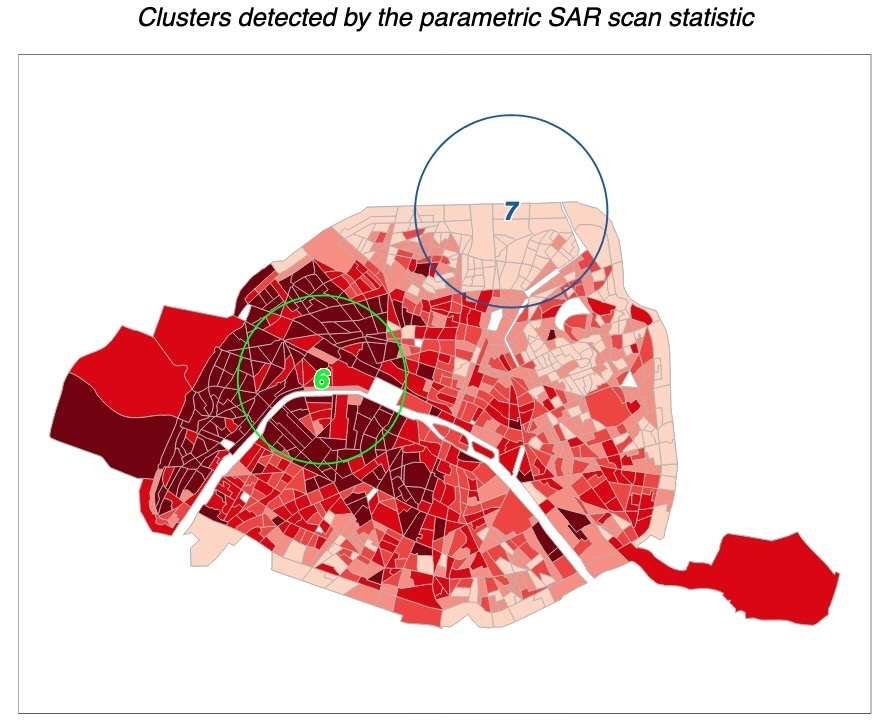

# Point Processes $\rightarrow$ Areal Processes

* The "Complete" Part of Complete Spatial Randomness (CSR)
* Bringing **Neighbors** Back In
* Spatial Regression

# Points $\rightarrow$ Areas {data-stack-name="Points &rarr; Areas"}

## Aggregating Point Processes

* Recall the **two** "stages" of our Poisson-based point processes
  * A **Poisson**-distributed number of points, then
  * **Uniformly**-distributed coordinates for each point
* One way to see **areal** data modeling: we *keep* the Poisson part, but we **no longer observe** the coordinates for the points!
* So... why is it still helpful for you to have sat through those lectures on Point Processes? Two reasons...

## (1) Areal Patterns = Aggregated Point Patterns {.title-09 .crunch-title .text-90}

* One application, mentioned last week: **areal-weighted interpolation** using actual **models** of how the points are distributed within the area!
* Regularly-spaced points is rarely a good "default" model!
* Humans, for example, rarely live at perfect evenly-spaced intervals... they form **households**, **villages**, **cities**
* Regularly-spaced points (we now know) $\implies$ **negative autocorrelation** $\implies$ typically due to **inhibition process** (competition)

## (2) Spatial Scan Statistics {.smaller}

* Areal regions often the result of **artificial** / "arbitrary" human divisions
  * (Particulate matter doesn't pass through customs)
* $\implies$ If we care about processes which don't "adhere to" borders (like disease spread), we want to "scan" **buffers** around points regardless of areal borders

{fig-align="center"}

## (3) Hierarchical Bayesian Smoothing {.title-08 .crunch-title .crunch-ul}

* The issue might just be **not enough data** for some areas, while we have an **abundance** of data in nearby areas...

{target='_blank'}](images/bayes_smoothing.png){fig-align="center"}

## Autocorrelation Reminder: Weight Matrix Defines "Neighbors" {.smaller .crunch-title .title-10}

{target='_blank'}](images/canada_dist.gif){fig-align="center"}

## Choices Available in `spdep` {.crunch-title .text-90 .inline-90}

* $w_{ij} = 1$ if $i$ and $j$ "touch"
  * Rook: Overlap is 1 or 2-dimensional
  * Queen: Overlap is 0, 1, or 2-dimensional
* $w_{ij} = \frac{1}{\text{dist}(i, j)}$
  * $w(\textsf{Seoul}, \textsf{Incheon})$ > $w(\textsf{Seoul}, \textsf{Busan})$ > $w(\textsf{Seoul}, \textsf{Jeju})$
* $w_{ij} = 1$ if $dist(i, j) < \overline{D}$
* $w_{ij} = 1$ for $K$ nearest neighbors

## Moran's $I$ One More Time

* Round 1 (Week 6): Moran's $I$ as "thermometer"
* Round 2 (Today): Could an $I$ value this extreme occur due to random noise?