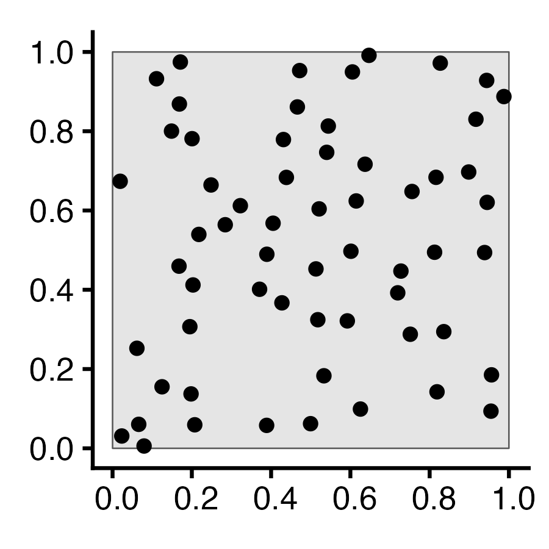
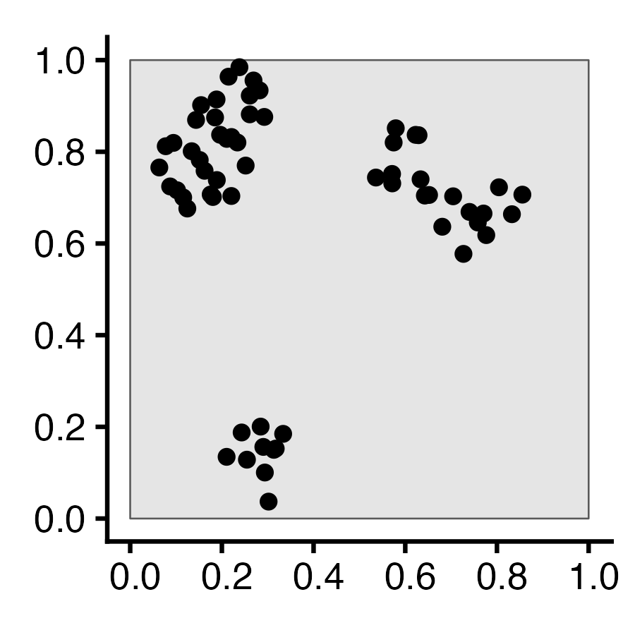
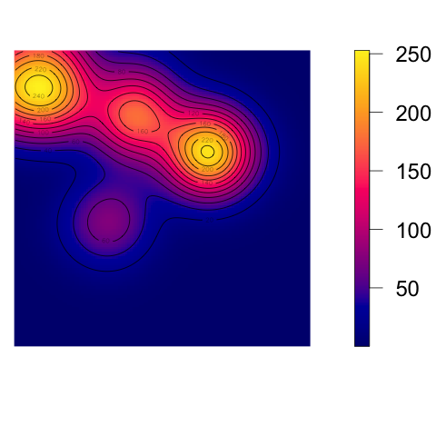
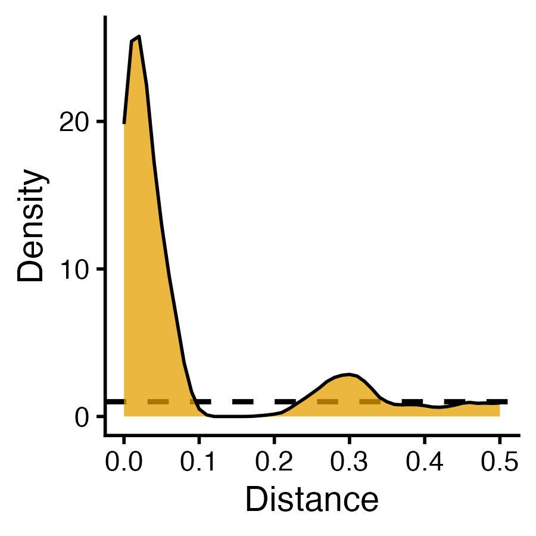
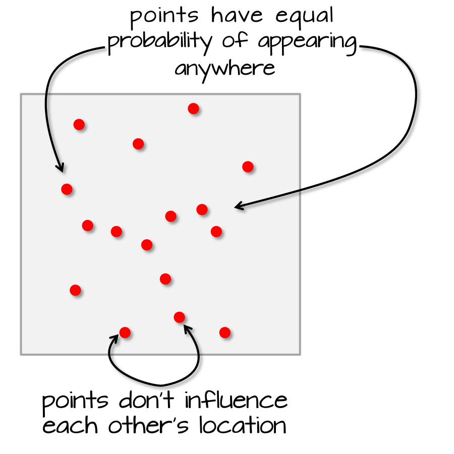

::: {.content-visible unless-format="revealjs"}

<center class='mb-3'>
<a class="h2" href="./slides.html" target="_blank">Open slides in new tab &rarr;</a>
</center>

:::

## Roadmap to the Midterm! {.text-60 .crunch-title .crunch-quarto-figure .crunch-table .crunch-img}

✅ Last Week (**Oct 21**): *Framework* for **Formalizing Point $\leadsto$ Areal Hypotheses**

```{=html}
<table>
<colgroup>
<col style='width: 28%;'>
<col style='width: 2%;'>
<col style='width: 40%;'>
<col style='width: 2%;'>
<col style='width: 28%;'>
</colgroup>
<thead>
<tr class='trnb'>
  <th class='tdc tdvc tdnb'>Repulsion</th>
  <th class='tdc tdvc tdnb'>&larr;</th>
  <th class='tdc tdvc'>Complete Spatial Randomness</th>
  <th class='tdc tdvc'>&rarr;</th>
  <th class='tdc tdvc tdnb'>Clustering</th>
</tr>
</thead>
</table>
```

```{=html}
<table>
<colgroup>
<col style='width: 33%;'>
<col style='width: 33%;'>
<col style='width: 33%;'>
</colgroup>
<tbody>
<tr>
  <td class='tdc tdvc'><span data-qmd="{.nostretch width='290'}"></span></td>
  <td class='tdc tdvc'><span data-qmd="{.nostretch width='290'}"></span></td>
  <td class='tdc tdvc'><span data-qmd="{.nostretch width='290'}"></span></td>
</tr>
</tbody>
</table>
```

* 🔲 Today (**Oct 28**): *Using* this framework to **Evaluate Point $\leadsto$ Areal Hypotheses**
* 🔲 Midterm (**Nov 4**): "Mini-homework" on Spatial Data Science unit (same topics as HW2-3)!

::: {.hidden}

```{r}
#| label: r-source-globals
source("../dsan-globals/_globals.r")
source("../dsan-globals/_globals-sf.r")
set.seed(6805)
library(tidyverse) |> suppressPackageStartupMessages()
library(sf) |> suppressPackageStartupMessages()
library(spatstat) |> suppressPackageStartupMessages()
library(mdthemes) |> suppressPackageStartupMessages()
library(leaflet) |> suppressPackageStartupMessages()
```

:::

## Where We Left Off: The Tree-Grid Mystery {.crunch-title .text-90 .crunch-ul .crunch-p}

You've been hired as an archaeologist -- congratulations! Your job: determine whether arrangement of **trees** formed:

* **Naturally**, via a process of **resource competition**, or
* **Artificially**, via an ancient civilization planting in a **grid**...

```{r, dev.args = list(bg = 'transparent')}
#| label: tree-mystery
#| echo: false
#| code-fold: true
#| fig-align: center
square_sf <- sf::st_as_sf(spatstat.geom::square(1))
grid_sf <- sf::st_as_sf(sf::st_make_grid(square_sf))
grid_buffer_sf <- grid_sf |> sf::st_buffer(dist=-0.01, singleSide = TRUE)
grid_points <- sf::st_sample(grid_buffer_sf, size=rep(1,100))
grid_ppp <- as.ppp(grid_points, W=spatstat.geom::square(1))
grid_ppp |> sf::st_as_sf() |> ggplot() +
  geom_sf() +
  theme_classic(base_size=24) +
  transparent_bg()
```

## Two Possible Histories... {.crunch-title .inline-90 .smaller .crunch-img .crunch-quarto-figure}

<center>
Hypothesis $\mathcal{H}_{\textsf{Art}}$: Artificial Formation
</center>

:::: {.columns}
::: {.column width="33%"}

```{r, dev.args = list(bg = 'transparent')}
#| label: artificial-grid
#| code-fold: true
#| code-summary: "Code (Step 1: Grid Creation)"
#| fig-width: 7
ha_base <- 28
square_sf <- sf::st_as_sf(spatstat.geom::square(1))
grid_sf <- sf::st_as_sf(sf::st_make_grid(square_sf))
grid_buffer_sf <- grid_sf |> sf::st_buffer(dist=-0.01, singleSide = TRUE)
grid_buffer_sf |> ggplot() +
  geom_sf() +
  theme_classic(base_size=ha_base) +
  transparent_bg()
```

:::
::: {.column width="33%"}

```{r, dev.args = list(bg = 'transparent')}
#| label: artificial-grid-points
#| code-fold: true
#| code-summary: "Code (Step 2: Point Generation)"
#| fig-width: 7
grid_points <- sf::st_sample(grid_buffer_sf, size=rep(1,100))
grid_buffer_sf |> ggplot(aes(shape='Cell')) +
  geom_sf() +
  geom_sf(data=grid_points) +
  scale_shape_manual("Shape", values=c('Cell'=19)) +
  theme_classic(base_size=ha_base) +
  theme(
    legend.title = element_blank(),
    # legend.text = element_text(size=18)
  ) +
    transparent_bg()
```

:::
::: {.column width="33%"}

```{r, dev.args = list(bg = 'transparent')}
#| label: artificial-grid-result
#| code-fold: true
#| code-summary: "Code (Step 3: Observed Result)"
#| fig-width: 7
grid_ppp <- as.ppp(grid_points, W=spatstat.geom::square(1))
grid_ppp |> sf::st_as_sf() |> ggplot() +
  geom_sf() +
  theme_classic(base_size=ha_base) +
  transparent_bg()
```

:::
::::

<center>
Hypothesis $\mathcal{H}_{\textsf{Nat}}$: Natural Formation
</center>

:::: {.columns}
::: {.column width="33%"}

```{r, dev.args = list(bg = 'transparent')}
#| label: gen-trees
#| code-fold: true
#| code-summary: "Code (Step 1: Tree Generation)"
#| fig-width: 7
hn_base <- 28
r <- 0.05
pois_ppp <- rpoispp(150)
pois_sf <- pois_ppp |> sf::st_as_sf()
pois_sf |> ggplot() +
  geom_sf() +
  theme_classic(base_size=hn_base) +
  transparent_bg()
```

:::
::: {.column width="34%"}

```{r, dev.args = list(bg = 'transparent')}
#| label: kill-trees
#| code-fold: true
#| code-summary: "Code (Step 2: Competition)"
#| fig-width: 7
#| fig-align: center
age <- runif(npoints(pois_ppp))
pair_dists <- pairdist(pois_ppp)
close <- (pair_dists < r)
later <- outer(age, age, ">")
killed <- apply(close & later, 1, any)
killed_ppp <- pois_ppp[killed]
alive_ppp <- pois_ppp[!killed]
pois_window_sf <- pois_ppp |> sf::st_as_sf() |> filter(label=="window")
pois_killed_sf <- killed_ppp |> sf::st_as_sf() |> filter(label=="point")
pois_alive_sf <- alive_ppp |> sf::st_as_sf() |> filter(label=="point")
alive_buff_sf <- pois_alive_sf |> sf::st_buffer(r) |> sf::st_union() |> sf::st_intersection(pois_window_sf)
ggplot() +
  geom_sf(data=pois_window_sf) +
  geom_sf(data=alive_buff_sf, aes(color='Inhibition', shape='Inhibition'), linetype='dashed') +
  geom_sf(data=pois_killed_sf, aes(color='Dead', shape='Dead'), size=2, stroke=2) +
  geom_sf(data=pois_alive_sf, aes(color='Alive', shape='Alive'), size=1, stroke=1) +
  scale_shape_manual(name=NULL, values=c("Alive"=19, "Dead"=4, 'Inhibition'=21), labels=c("Alive", "Dead", "Inhibition")) +
  scale_color_manual(name=NULL, values=c("Alive"="black", "Dead"=cb_palette[1], "Inhibition"="black"), labels=c("Alive", "Dead", "Inhibition")) +
  guides(shape=guide_legend(override.aes=list(fill = "white"))) +
  theme_classic(base_size = hn_base) +
  theme(plot.margin = unit(c(0,0,0,0), "cm")) +
  transparent_bg()
```

:::
::: {.column width="32%"}

```{r, dev.args = list(bg = 'transparent')}
#| label: post-tree-killing
#| code-fold: true
#| code-summary: "Code (Step 3: Observed Result)"
#| fig-width: 7
alive_ppp |> sf::st_as_sf() |> ggplot() +
  geom_sf() +
  theme_classic(base_size=hn_base) +
  transparent_bg()
```

:::
::::

# What *Tools* Do We Have for *Distinguishing Between* These Cases? {.text-725 .title-13 data-stack-name="First/Second Moments"}

:::: {.columns}
::: {.column width="45%"}

<center>

**"First-Order"** measures

</center>

:::
::: {.column width="5%"}

<center>

**vs.**

</center>

:::
::: {.column width="50%"}

<center>

**"Second-Order"** measures

</center>

:::
::::

:::: {.columns}
::: {.column width="45%"}

* Pick **any point** ("site") $\mathbf{s}$ on map
* What is $\Pr($Event occurs at $\mathbf{s})$?

:::
::: {.column width="5%"}

:::
::: {.column width="50%"}

* Assume **already-observed event** at $\mathbf{s}$
* What is $\Pr($*Another* event nearby $\mathbf{s})$?

:::
::::

## *Why* Do Events Appear Where They Do? {.smaller .title-12 .inline-95 .nostretch .text-60}

```{r, dev.args = list(bg = 'transparent')}
#| label: sr-plot2
#| code-fold: true
#| output: false
#| fig-align: center
#| fig-width: 4
#| fig-height: 4
#| crop: true
library(tidyverse)
library(spatstat)
set.seed(6809)
N <- 60
r_core <- 0.05
obs_window <- square(1)
### Clustered data
clust_ppp <- rMatClust(
  kappa=6,
  scale=r_core,
  mu=10
)
clust_sf <- clust_ppp |> sf::st_as_sf()
clust_plot <- clust_sf |>
  ggplot() +
  geom_sf(size=2) +
  theme_classic(base_size=18) +
  transparent_bg()
ggsave("images/clust_ppp.png", clust_plot, width=3, height=3)
# Intensity fn
clust_intensity <- density(clust_ppp, sigma = 0.1)
png("images/clust_intensity.png")
par(mar=c(1.5,0,0,2), las=2, oma=c(0,0,0,0), cex=2, bg=NA)
plot(clust_intensity, main=NULL)
contour(clust_intensity, add = TRUE)
dev.off()
### PCF
clust_pcf <- spatstat.explore::pcf(
  clust_ppp, divisor="d",
  r=seq(from=0.00, to=0.50, by=0.01)
)
clust_pcf_plot <- clust_pcf |> ggplot(aes(x=r, y=iso)) +
  geom_hline(yintercept=1, linetype='dashed', linewidth=1) +
  geom_area(color='black', fill=cb_palette[1], alpha=0.75) +
  scale_x_continuous(breaks=seq(from=0.0, to=1.0, by=0.1)) +
  labs(x="Distance", y="Density") +
  theme_classic(base_size=14) +
  transparent_bg()
ggsave("images/clust_pcf.png", clust_pcf_plot, width=3, height=3)
```

```{=html}
<table style='width: 100%; table-layout: fixed;'>
<colgroup>
  <col style='width: 31%;' />
  <col style='width: 33%;' />
  <col style='width: 36%;' />
</colgroup>
<thead>
<tr>
  <th align="center">Original Data</th>
  <th>First-Order</th>
  <th>Second-Order</th>
</tr>
</thead>
<tbody>
<tr>
  <td class='tdvc' align="center"><span data-qmd="$N = 60$ Events"></span></td>
  <td class='tdvc'><span data-qmd="Events modeled **individually**<br>$\Rightarrow$ **Intensity Function $\lambda(\mathbf{s})$**"></span></td>
  <td><span data-qmd="Events modeled **pairwise** $\Rightarrow$ **Pairwise-Corr Function** $\textrm{pcf}(\vec{h})$"></span></td>
</tr>
<tr>
  <td></td>
  <td class='tdvc'></td>
  <td class='tdvc'></td>
</tr>
</tbody>
</table>
```

## What Do These Functions "Detect"? {.crunch-title .smaller .crunch-img .crunch-quarto-figure .crunch-columns .title-12}

:::: {.columns}
::: {.column width="33%"}

```{r, dev.args = list(bg = 'transparent')}
#| label: sq-point-plot
#| code-fold: true
#| fig-width: 2.75
#| fig-height: 2.75
#| code-summary: "Code (Fixed Points)"
sq_base <- 16
sq_psize <- 2.5
obs_window <- square(1)
r0 <- 0.2
sq_df <- tibble::tribble(
  ~x, ~y,
  0.5-r0,0.5-r0,
  0.5+r0,0.5+r0,
  0.5-r0,0.5+r0,
  0.5+r0,0.5-r0
)
sq_sf <- sf::st_as_sf(
  sq_df,
  coords = c("x","y")
)
sq_ppp <- as.ppp(sq_sf, W=obs_window)
sq_ppp |> sf::st_as_sf() |> ggplot() +
  geom_sf(size=sq_psize) +
  theme_classic(base_size=sq_base) +
  transparent_bg()
```

:::
::: {.column .summary-mb width="33%"}

```{r, dev.args = list(bg = 'transparent')}
#| label: sq-intensity-plot
#| code-fold: true
#| fig-width: 3
#| fig-height: 2.5
#| crop: true
par(
  mar=c(0,0,1,2),
  # mai=c(0,0,0.1,0),
  las=2,
  oma=c(0,0,1,0)
)
sq_density <- density(sq_ppp)
plot(sq_density, main=NULL, xaxs='i', yaxs='i', bg=NA)
contour(sq_density, xaxs='i', yaxs='i', add = TRUE)
```

:::
::: {.column width="33%"}

```{r, dev.args = list(bg = 'transparent')}
#| label: sq-pcf-plot
#| code-fold: true
#| fig-width: 5
#| fig-height: 4
### PCF
pcf_result <- spatstat.explore::pcf(
  sq_ppp,
  divisor="d",
  r=seq(from=0.00, to=0.8, by=0.01)
)
pcf_result |> ggplot(aes(x=r, y=iso)) +
  geom_hline(yintercept=1, linetype='dashed', linewidth=1.5) +
  geom_area(color='black', fill=cb_palette[1], alpha=0.75) +
  scale_x_continuous(breaks=seq(from=0.0, to=1.0, by=0.1)) +
  theme_classic(base_size=sq_base) +
  transparent_bg()
```

:::
::::

<!-- CSR pattern -->

:::: {.columns}
::: {.column width="33%"}

```{r, dev.args = list(bg = 'transparent')}
#| label: csr-properties-plot
#| code-fold: true
#| fig-height: 2.75
#| fig-width: 2.75
#| code-summary: "Code (CSR Points)"
csr_ppp <- spatstat.random::rpoispp(
  lambda = 60,
  win=obs_window
)
csr_ppp |> sf::st_as_sf() |> ggplot() +
  geom_sf(size=sq_psize) +
  theme_classic(base_size=sq_base) +
  transparent_bg()
```

:::
::: {.column .summary-mb width="33%"}

```{r, dev.args = list(bg = 'transparent')}
#| label: csr-intensity-plot
#| code-fold: true
#| fig-width: 3
#| fig-height: 2.5
#| crop: true
par(
  mar=c(0,0,1,2),
  las=2,
  oma=c(0,0,1,0)
)
csr_density <- density(csr_ppp)
plot(csr_density, main=NULL, xaxs="i", yaxs="i", bg=NA)
contour(csr_density, xaxs="i", yaxs="i", add = TRUE, lwd=1.5)
```

:::
::: {.column width="33%"}

```{r, dev.args = list(bg = 'transparent')}
#| label: csr-pcf-plot
#| code-fold: true
#| fig-width: 5
#| fig-height: 4
csr_pcf_result <- spatstat.explore::pcf(
  csr_ppp,
  divisor="d",
  r=seq(from=0.00, to=0.8, by=0.01)
)
csr_pcf_result |> ggplot(aes(x=r, y=iso)) +
  geom_hline(yintercept=1, linetype='dashed', linewidth=1.5) +
  geom_area(color='black', fill=cb_palette[1], alpha=0.75) +
  scale_x_continuous(breaks=seq(from=0.0, to=1.0, by=0.1)) +
  theme_classic(base_size=sq_base) +
  transparent_bg()
```

:::
::::

# A Menagerie of Models {.text-80 .math-70 .title-12 .not-title-slide data-stack-name="Models"}

<center>

[[Open Interactive (WebR) Version](https://jjacobs.me/gis-webr){.external}]{.boxed-cb}

</center>

* *(...Interactivity is genuinely important here! Why? Hint:)*

$$
\begin{aligned}
\text{Point Processes } \underbrace{\Omega}_{\mathclap{\text{Model of possible worlds}}} & ~~~~~~~~~~~~~\text{vs.} &
\textit{Realizations}\text{ of Point Processes }\underbrace{\omega_1, \omega_2, \ldots}_{\mathclap{\text{Observed worlds}}}
\end{aligned}
$$


## Poisson Point Processes (CSR) {.crunch-title .crunch-img .crunch-ul .inline-90 .crunch-p}

``` {.r}
spatstat.random::rpoispp(lambda, win)
```

* <i class='bi bi-1-circle'></i> $N \sim \text{Pois}(\lambda)$
* <i class='bi bi-2-circle'></i> For $i \in \{1, \ldots, N\}$:
  * Generate $X_i, Y_i \sim \mathcal{U}(\texttt{win})$

```{r, dev.args = list(bg = 'transparent')}
#| label: pois-ppp-sims
#| code-fold: true
#| fig-align: center
#| crop: true
sim_base <- 20
sim_psize <- 2
sim_xticks <- seq(from=0.0, to=1.0, by=0.2)
sim_yticks <- seq(from=0.0, to=1.0, by=0.2)
gen_pois_df <- function(num_sims=1) {
  pois_sims <- spatstat.random::rpoispp(
    lambda = 60, nsim=num_sims
  )
  return(tibble::as_tibble(pois_sims))
}
#pois_dfs <- gen_pois_df()
#pois_dfs |> head()
pois_sims <- spatstat.random::rpoispp(
  lambda = 60, nsim=3
)
to_sim_df <- function(cur_sim, sim_name) {
  cur_df <- tibble::as_tibble(cur_sim) |> mutate(sim=sim_name)
  return(cur_df)
}
combined_df <- imap(.x=pois_sims, .f=to_sim_df) |> bind_rows()
combined_df |> ggplot(aes(x=x, y=y)) +
  geom_point(size=sim_psize) +
  facet_wrap(vars(sim)) +
  coord_equal() +
  theme_classic(base_size=sim_base) +
  theme(panel.spacing.x = unit(2, "lines")) +
  scale_x_continuous(breaks=sim_xticks) +
  scale_y_continuous(breaks=sim_yticks) +
  transparent_bg()
```

## Simple Sequential Inhibition (SSI) {.smaller .crunch-title .title-11 .inline-90 .code-90 .crunch-img .crunch-quarto-figure .crunch-ul .crunch-p}

``` {.r}
spatstat.random::rSSI(r, n=Inf, giveup=1000, win)
```

* $\mathbf{S} = \varnothing$
* While not `done`:
  * <i class='bi bi-1-circle'></i> Generate $\mathbf{E} = (X, Y) \sim \mathcal{U}(\texttt{win})$
  * <i class='bi bi-2-circle'></i> Check if $\mathbf{E}$ within `r` units of any existing point in $\mathbf{S}$
    * If it is, **throw $\mathbf{E}$ away**. Otherwise, **add $\mathbf{E}$ to $\mathbf{S}$**
  * <i class='bi bi-3-circle'></i> `done=TRUE` if $\mathbf{S}$ has `n` points OR has been the same for `giveup` steps

```{r, dev.args = list(bg = 'transparent')}
#| label: ssi-sims
#| code-fold: true
#| fig-align: center
#| warning: false
#| crop: true
capture.output(ssi_sims <- spatstat.random::rSSI(
  r = 0.05, n=60, nsim=3
), file=nullfile())
combined_df <- imap(.x=ssi_sims, .f=to_sim_df) |> bind_rows()
combined_df |> ggplot(aes(x=x, y=y)) +
  geom_point(size=sim_psize) +
  facet_wrap(vars(sim)) +
  coord_equal() +
  theme_classic(base_size=24) +
  theme(panel.spacing.x = unit(3, "lines")) +
  scale_x_continuous(breaks=sim_xticks) +
  scale_y_continuous(breaks=sim_yticks) +
  transparent_bg()
```

## Matérn Cluster Process {.crunch-title .smaller .code-90 .crunch-p .crunch-ul}

:::: {.columns}
::: {.column width="75%"}

``` {.r}
spatstat.random::rMatClust(kappa, scale, mu, win)
```

:::
::: {.column width="25%"}

[Docs](https://search.r-project.org/CRAN/refmans/spatstat.random/html/rMatClust.html){target='_blank'}

:::
::::

* <i class='bi bi-1-circle'></i> Generate $K(\kappa)$ **parent points** via Poisson Point Process with intensity $\lambda = \kappa$
* <i class='bi bi-2-circle'></i> For each parent point $\mathbf{s}_i \in \left\{\mathbf{s}_1, \ldots, \mathbf{s}_{K(\kappa)}\right\}$:
  * Generate $N(\mu)$ **offspring points** via Poisson Point Process with intensity $\lambda = \mu$, distributed uniformly within a **circle of radius `scale`** centered at $\mathbf{s}_i$
* <i class='bi bi-3-circle'></i> **Offspring points** form the outcome (parent points are thrown away)

```{r, dev.args = list(bg = 'transparent')}
#| label: matclust-plot
#| code-fold: true
#| fig-align: center
#| crop: true
matclust_sims <- rMatClust(
  kappa = 6,
  scale = 0.075,
  mu = 10,
  nsim = 3
)
matclust_df <- imap(.x=matclust_sims, .f=to_sim_df) |> bind_rows()
matclust_plot <- matclust_df |> ggplot(aes(x=x, y=y)) +
  geom_point(size=sim_psize) +
  facet_wrap(vars(sim), nrow=1) +
  coord_equal() +
  theme_classic(base_size=sim_base) +
  theme(panel.spacing.x = unit(2, "lines")) +
  scale_x_continuous(breaks=sim_xticks) +
  scale_y_continuous(breaks=sim_yticks) +
  transparent_bg()
matclust_plot
```

## Matérn Inhibition Process (I and II) {.smaller .crunch-title .inline-85 .crunch-ul .title-12 .text-65 .crunch-p}

:::: {.columns}
::: {.column width="50%"}

``` {.r}
spatstat.random::rMaternI(kappa, r, win)
```

:::
::: {.column width="50%"}

``` {.r}
spatstat.random::rMaternII(kappa, r, win)
```

:::
::::

```{=html}
<table>
<thead>
<tr>
  <th align="center"><span data-qmd="**`rMaternI()`** \[[Docs](https://search.r-project.org/CRAN/refmans/spatstat.random/html/rMaternI.html){target='_blank'}\]"></span></th>
  <th align="center"><span data-qmd="**`rMaternII()`** \[[Docs](https://search.r-project.org/CRAN/refmans/spatstat.random/html/rMaternII.html){target='_blank'}\]
</center>"></span></th>
</tr>
</thead>
<tbody>
<tr>
  <td class='tdvt'><div data-qmd="* <i class='bi bi-1-circle'></i> Generate events $\mathbf{S} = \{\mathbf{s}_1, \ldots, \mathbf{s}_{N(\lambda)}\}$ via Poisson point process with $\lambda = \kappa$"></div></td>
  <td class='tdvt'><div data-qmd="* <i class='bi bi-1-circle'></i> Generate events $\mathbf{S} = \{\mathbf{s}_1, \ldots, \mathbf{s}_{N(\lambda)}\}$ via Poisson point process with $\lambda = \kappa$, plus **timestamp** $t_i \sim \mathcal{U}(0,1)$ for each $\mathbf{s}_i$"></div></td>
</tr>
<tr>
  <td class='tdvt'><div data-qmd="* <i class='bi bi-2-circle'></i> Delete all **pairs** of points $\mathbf{s}_i$, $\mathbf{s}_j$ for which $\textsf{dist}(\mathbf{s}_i, \mathbf{s}_j) < \texttt{r}$"></div></td>
  <td><div data-qmd="* <i class='bi bi-2-circle'></i> For each pair of points $\mathbf{s}_i$, $\mathbf{s}_j$: if $\textsf{dist}(\mathbf{s}_i, \mathbf{s}_j) < \texttt{r}$, delete the **later** point"></div></td>
</tr>
</tbody>
</table>
```

```{r, dev.args = list(bg = 'transparent')}
#| label: matern-inhib-plots
#| code-fold: true
#| fig-align: center
#| crop: true
mI_sims <- rMaternI(
  kappa = 60, r = 0.075, nsim=2
)
mII_sims <- rMaternII(
  kappa = 60, r = 0.075, nsim=2
)
mI_combined_df <- imap(.x=mI_sims, .f=to_sim_df) |> bind_rows() |> mutate(sim=paste0("MI ",sim))
mII_combined_df <- imap(.x=mII_sims, .f=to_sim_df) |> bind_rows() |> mutate(sim=paste0("MII ",sim))
m_combined_df <- bind_rows(mI_combined_df, mII_combined_df)
m_plot <- m_combined_df |> ggplot(aes(x=x, y=y)) +
  geom_point(size=sim_psize) +
  facet_wrap(vars(sim), nrow=1) +
  coord_equal() +
  theme_classic(base_size=sim_base) +
  theme(panel.spacing.x = unit(2, "lines")) +
  scale_x_continuous(breaks=sim_xticks) +
  scale_y_continuous(breaks=sim_yticks) +
  transparent_bg()
m_plot
```

## Cox Processes: Random Intensity &rarr; Random Events {.smaller .crunch-title .title-10 .code-90}

:::: {.columns}
::: {.column width="70%"}

``` {.r}
spatstat.random::rLGCP(model, mu, param, win)
models=c("exponential", "gauss", "stable", "gencauchy", "matern")
```

:::
::: {.column width="30%"}

[Docs](https://search.r-project.org/CRAN/refmans/spatstat.random/html/rLGCP.html){target='_blank'}

:::
::::

```{r, dev.args = list(bg = 'transparent')}
#| label: lgcp-sim
#| code-fold: true
#| fig-align: center
#| crop: true
cox_pcol <- "black"
cox_bg <- "grey90"
cox_pch <- 21
# inhomogeneous LGCP with Gaussian covariance function
m <- as.im(function(x, y){
  5 - 1.5 * (x - 0.5)^2 + 2 * (y - 0.5)^2
}, W=owin())
lgcp_sims <- rLGCP("gauss", m, var=0.15, scale =0.5, nsim=3)
# lgcp_combined_df <- imap(.x=ssi_sims, .f=to_sim_df) |> bind_rows()
plot_lgcp <- function(lgcp_sim) {
  plot(attr(lgcp_sim, "Lambda"), main=NULL)
  points(lgcp_sim, col=cox_pcol, bg=cox_bg, pch=cox_pch)
}
par(mfrow=c(1,3), mar=c(0,0,0,2), oma=c(0,0,0,0), las=2)
nulls <- lapply(X=lgcp_sims, FUN=plot_lgcp)
```

# *Heterogeneous* Point Processes {.crunch-title .text-70 .crunch-ul data-stack-name="Base Rates"}

* Cox Process highlights a crucial simplifying assumption we've made up til now: **homogeneous** point processes

  ::: {.callout-tip title="Homogeneous Point Process"}

  Points are distributed such that intensity $\lambda$, expected \# of cases per unit area, is a **constant** across the study area

  :::

* Allows "eyeballing" clusters: areas w/more points than expected under **uniformity**
* But... in many cases we expect (e.g.) **greater density of people in cities!**

  ::: {.callout-tip title="Heterogeneous Point Process"}

  Distribution of points is determined by intensity *function* $\lambda(\mathbf{s})$, expected \# of cases per unit area **around $\mathbf{s}$**

  :::

## The Point: Base Rates $\Rightarrow$ Null Models! {.crunch-title .text-80 .inline-80}

* A **"baseline" intensity *function***, $\lambda(\mathbf{s})$ (possibly $c$ for all $\mathbf{s}$) defines a **null model**, from which we can simulate a bunch of **point patterns**...
* Then we *compare*: How does an **observed** point pattern **differ** from these simulated point patterns?
* *Not expecting* any clusters? Prior expectation = **Uniform** distribution $\Rightarrow$ null model = homogeneous point process<br> <i class="bi bi-arrow-return-right" style='margin-left: 4px;'></i> *Do I see clustering? $I \overset{\tiny{?}}{\gg} 0$*
* *Expecting* clusters in cities? Prior expectation = **Population density** $\Rightarrow$ null model = heterogeneous point process<br> <i class="bi bi-arrow-return-right" style='margin-left: 4px;'></i> *Do I see clustering **above and beyond** what I expected? $I_{\text{obs}} \overset{\tiny{?}}{\gg} I_{\text{base}}$*

## These Null Models Have *Names!* {.crunch-title .crunch-math .crunch-ul .text-90}

* Not expecting any clusters? Null model = **Complete Spatial Randomness (CSR)**
* Expecting clusters (e.g.) in cities? Null model = **Constant Risk Hypothesis**
* Why "constant **risk**"? From epidemiology:

$$
\underbrace{\rho(\mathbf{s})}_{\text{Risk near }\mathbf{s}} 
~~=~~~~~~ \frac{
  \overbrace{\lambda(\mathbf{s})}^{\mathclap{\text{Density of cases near }s}}
}{
  \underbrace{\lambda_0(\mathbf{s})}_{\mathclap{\text{Population density near }\mathbf{s}}}
}
$$

## Constant Risk Hypothesis: Motivation {.text-65 .crunch-title}

* Here is a (fictional) map of 2026 flu cases in the US "Midwest"
* Are people in [**Chicago (pop. 2,731,585)**]{style="color: #4b0055; -webkit-text-stroke: 4px white; paint-order: stroke fill;"} and [**Detroit (pop. 649,095)**]{style="color: #f1d202; -webkit-text-stroke: 4px black; paint-order: stroke fill;"} equally "at risk"?

```{r}
#| label: midwest-cases-plot
#| code-fold: true
library(mapview) |> suppressPackageStartupMessages()
city_df <- tibble::tribble(
  ~city, ~lon, ~lat, ~pop,
  "Chicago", 41.950567516553896, -87.93011127491978, 2746388,
  "Detroit", 42.45123004999075, -83.18402319217698, 631524
)
city_sf <- sf::st_as_sf(
  city_df,
  coords = c("lat", "lon"),
  crs=4326
)
city_buf_sf <- city_sf |> sf::st_buffer(20000)
city_cases_sf <- city_buf_sf |> sf::st_sample(size=rep(10,2)) |> sf::st_as_sf()
city_cases_sf$city <- "Detroit (10 Cases)"
city_cases_sf[1:10, 'city'] <- "Chicago (10 Cases)"
city_cases_sf$sample <- "Flu"
mapview(city_cases_sf, zcol="city")
```

## Constant Risk Hypothesis: Base Rates {.smaller .crunch-title .title-12}

```{=html}
<style>
.highlight-icon {
  color: #e69f00;
}
</style>
```

| | Chicago | Detroit |
|-|-|-|
| **Population** | 2,731,585 | 649,095 |

```{r}
#| label: midwest-pop-plot
#| code-fold: true
library(leaflet) |> suppressPackageStartupMessages()
library(leaflet.extras2) |> suppressPackageStartupMessages()
city_pop_sf <- city_buf_sf |> sf::st_sample(size=c(16, 4)) |> sf::st_as_sf()
city_pop_sf$city <- "Detroit"
city_pop_sf[1:16, 'city'] <- "Chicago"
city_pop_sf$sample <- "People"
city_combined_sf <- bind_rows(city_cases_sf, city_pop_sf)
# mapview(city_combined_sf, zcol="city", marker="sample")
Flu = makeIcon(
    iconUrl="images/Maki2-danger-24.svg",
    iconRetinaUrl="images/Maki2-danger-24.svg",
    iconWidth=20,
    iconHeight=20,
    className='highlight-icon'
)
People = makeIcon(
  iconUrl="https://upload.wikimedia.org/wikipedia/commons/e/ef/Maki2-pitch-24.svg",
  iconRetinaUrl="https://upload.wikimedia.org/wikipedia/commons/e/ef/Maki2-pitch-24.svg",
  iconWidth=20,
  iconHeight=20,
  # className='boxed-cb'
)

city_combined_sf$r <- ifelse(city_combined_sf$sample == "Flu", 0, 4)
city_flu_sf <- city_combined_sf |> filter(sample == "Flu")
city_ppl_sf <- city_combined_sf |> filter(sample == "People")
leaflet(city_flu_sf) |>
  addProviderTiles("Esri.WorldGrayCanvas") |>
  # addProviderTiles("CartoDB.Positron") |>
  addMarkers(data=city_flu_sf, icon = Flu) |>
  addMarkers(data=city_ppl_sf, icon = People)
```

## Example from Moraga (2024) {.smaller .crunch-title .crunch-ul .crunch-quarto-figure .text-65 .inline-80}

* [Data](https://tilmandavies.github.io/sparr/reference/pbc.html){target='_blank'}: $N = 761$ [primary biliary cirrhosis (PBC) cases](https://pubmed.ncbi.nlm.nih.gov/11731995/){target='_blank'}, $N_0 = 3020$ controls, UK 1987-94

:::: {.columns}
::: {.column width="50%"}

```{r, dev.args = list(bg = 'transparent')}
#| label: plot-raw-controls
#| code-fold: true
#| crop: true
#| fig-width: 3
#| fig-align: center
library(sparr) |> suppressPackageStartupMessages()
data(pbc)
controls <- unmark(pbc[which(pbc$marks == "control"), ])
controls |> sf::st_as_sf() |> ggplot() +
  geom_sf() +
  theme_classic() +
  labs(title="Controls (Population Sample)") +
  transparent_bg()
```

:::
::: {.column width="50%"}

```{r, dev.args = list(bg = 'transparent')}
#| label: plot-raw-cases
#| code-fold: true
#| crop: true
#| fig-width: 3
#| fig-align: center
cases <- unmark(pbc[which(pbc$marks == "case"), ])
cases |> sf::st_as_sf() |> ggplot() +
  geom_sf() +
  theme_classic() +
  labs(title="PBC Cases") +
  transparent_bg()
```

:::
::::

## Estimating Comparable Intensity Surfaces {.title-11 .crunch-title .smaller .crunch-details .crunch-p .crunch-ul .crunch-img}

* To ensure comparable **intensity functions**, need a common **bandwidth** value
* `density()` from `spatstat` makes "smart" choices for this bandwidth, so for now we just **average** the bandwidths estimated for cases and controls:

```{r, dev.args = list(bg = 'transparent')}
#| label: mean-density
#| code-fold: true
library(sparr)
data(pbc)
par(mar=c(2,0,2,0))
cases <- unmark(pbc[which(pbc$marks == "case"), ])
controls <- unmark(pbc[which(pbc$marks == "control"), ])
bwcases <- attr(density(cases), "sigma")
bwcontr <- attr(density(controls), "sigma")
(bw <- (bwcases + bwcontr)/2)
```

:::: {.columns}
::: {.column width="50%"}

```{r, dev.args = list(bg = 'transparent')}
#| label: plot-controls-density
#| fig-width: 3
#| fig-height: 3.75
#| fig-align: center
#| crop: true
int_controls <- density(controls, sigma = bw, eps=0.25)
plot(int_controls, main = "λ(Controls)", bg=NA)
```

:::
::: {.column width="50%"}

```{r}
#| label: plot-cases-density-init
#| echo: false
par(mar=c(2,0,2,0))
```

```{r, dev.args = list(bg = 'transparent')}
#| label: plot-cases-density
#| fig-width: 3
#| fig-height: 3.75
#| fig-align: center
#| crop: true
int_cases <- density(cases, sigma = bw, eps=0.25)
plot(int_cases, main = "λ(Cases)", bg=NA)
```

:::
::::

## Visualizing Relative Risk Surface {.smaller .crunch-title .crunch-ul .inline-90}

:::: {.columns}
::: {.column width="40%"}

To account for $N_0 \neq N$, *normalize* numerator and denominator:

$$
\hat{\rho}(\mathbf{s}) = \frac{\hat{\lambda}(\mathbf{s}) / N}{\hat{\lambda}_0(\mathbf{s}) / N_0}
$$

$\Rightarrow \hat{\rho}(\mathbf{s}) = \frac{\hat{\lambda}(\mathbf{s})}{\alpha\hat{\lambda}_0(\mathbf{s})}$, where $\alpha = \frac{N}{N_0}$

```{r}
#| label: uk-compute-alpha
(alpha <- cases$n/controls$n)
```

:::
::: {.column width="60%"}

```{r, dev.args = list(bg = 'transparent')}
#| label: cases-controls-plot
#| code-fold: true
#| fig-width: 5
#| crop: true
library(fields)
library(scico)
x <- int_cases$xcol
y <- int_cases$yrow
rr <- t(int_cases$v)/t(alpha * int_controls$v)
center <- 1.0
lim <- max(abs(rr - center), na.rm = TRUE)
# pal <- colorRampPalette(c("#2166AC", "white", "#B2182B"))(101)
par(
  mar=c(6.5,3,1.5,0.5),
  oma=c(1,1,1,1),
  xpd=NA,
  mgp = c(1.6, 0.6, 0)
)
pal <- scico(101, palette = "vik")
image.plot(x, y, rr, asp = 1, col=pal, zlim = c(center - lim, center + lim), main="Relative Risk Surface", xlab="Easting", ylab="Northing", bty='l')
```

:::
::::

# From Exploratory to Confirmatory Data Analysis {data-stack-name="Monte Carlo" .smaller .title-10 .not-title-slide .crunch-title}

* How do we know whether &uarr; risk around **North Newcastle** due to "chance"? Maybe relative risk is actually constant, and people in Newcastle are just **unlucky**...
* Thought experiment: Bro hands you a coin. You flip **10 times**. `HHHHHTHHHH`...
* Coin **may** be biased-towards-`H`, **or** could be **fair** (lots of heads **by chance!**)
* **Stats**: Compare with **null model!** For fair coin, how **likely** is [9 Heads / 10 Flips]?

:::: {.columns}
::: {.column width="50%"}

{fig-align="center" width="80%"}

:::
::: {.column width="50%"}

{fig-align="center" width="90%"}

:::
::::

## Null Model: CSR

{fig-align="center"}

## The *Random Labeling Hypothesis* {.smaller}

<div style="width: 100%;">

* Randomly apply 761 "sick" labels to the $761 + 3020 = 3781$ points!

</div>

:::: {.columns}
::: {.column width="33%"}

```{r, dev.args = list(bg = 'transparent')}
#| label: random-labeling
#| code-fold: true
#| fig-width: 4.8
#| fig-height: 6
#| crop: true
plot_rlabel <- function(rl_ppp) {
  rl_win_sf <- window_to_sf(rl_ppp)
  rl_points_sf <- points_to_sf(rl_ppp) |>
    rename(
      type = spatstat.geom..marks.x.
    )
  rl_plot <- ggplot() +
    geom_sf(
      data=rl_win_sf,
      alpha=0.3
    ) +
    geom_sf(
      mapping=aes(fill=type, alpha=type),
      data=rl_points_sf,
      size=2,
      # alpha=0.75,
      shape=21,
      stroke=0.1,
      # color='white',
    ) +
    # scale_color_manual(
    #   "Point Type",
    #   values=c("control"="gray","case"=cb_palette[1])
    # ) +
    scale_fill_manual(
      "Type",
      values=c("control"="gray","case"=cb_palette[1])
    ) +
    scale_alpha_manual(
      "Type",
      values=c("control"=0.5, "case"=1.0)
    ) +
    theme_classic(base_size=16) +
    labs(
      title="NE Britain Disease Cases"
    ) +
    transparent_bg()
  return(rl_plot)
}
set.seed(6810)
rl1_ppp <- rlabel(pbc)
plot_rlabel(rl1_ppp)
```

:::
::: {.column width="33%"}

```{r, dev.args = list(bg = 'transparent')}
#| label: random-labeling-2
#| code-fold: true
#| fig-width: 4.8
#| fig-height: 6
#| crop: true
set.seed(6811)
pbc_2 <- rlabel(pbc)
plot_rlabel(pbc_2)
```

:::
::: {.column width="33%"}

```{r, dev.args = list(bg = 'transparent')}
#| label: random-labeling-3
#| code-fold: true
#| fig-width: 4.8
#| fig-height: 6
#| crop: true
set.seed(6812)
pbc_3 <- rlabel(pbc)
plot_rlabel(pbc_3)
```

:::
::::

## The *Constant Risk Hypothesis* {.smaller}

* Everyone **equally at risk** of contracting disease, **regardless** of location: $\rho(\mathbf{s}) = 1$
* In this case: $\lambda_{CR}(\mathbf{s}) = \alpha \lambda_0(\mathbf{s})$ (some constant $\alpha$ $\times$ base rate $\lambda_0(\mathbf{s})$)

:::: {.columns}
::: {.column width="33%"}

```{r, dev.args = list(bg = 'transparent')}
#| label: monte-carlo-sim
#| code-fold: true
#| fig-width: 2.5
#| crop: true
pbc_win_sf <- pbc |> sf::st_as_sf() |> filter(label == "window")
plot_pbc_sim <- function() {
    pbc_sim <- spatstat.random::rpoispp(
        lambda = alpha * int_controls
    )
    # Separate window and points
    pbc_sf <- pbc_sim |> sf::st_as_sf()
    pbc_point_sf <- pbc_sf |> filter(label == "point")
    pbc_win_sf <- pbc_sf |> filter(label == "window")
    pbc_plot <- ggplot() +
      geom_sf(data=pbc_win_sf) +
      geom_sf(data=pbc_point_sf, size=0.5, alpha=0.5) +
      theme_classic() +
      transparent_bg()
    return(pbc_plot)
}
plot_pbc_sim()
```

:::
::: {.column width="33%"}

```{r, dev.args = list(bg = 'transparent')}
#| code-fold: true
#| fig-width: 2.5
#| crop: true
plot_pbc_sim()
```

:::
::: {.column width="33%"}

```{r, dev.args = list(bg = 'transparent')}
#| code-fold: true
#| fig-width: 2.5
#| crop: true
plot_pbc_sim()
```

:::
::::

# HW3 Tips! {data-stack-name="HW3"}

* `ppp` Objects
* Converting between `ppp` and `sf`
* Plotting

## `ppp` Objects {.smaller .crunch-title .crunch-ul .smaller-table}

* The **main** datatype used to represent **P**lanar **P**oint **P**atterns [`spatstat` book p. 41]
* Unlike `sf` objects, which contain data+geometries for any desired collection of $N$ entities, `ppp` objects are **required** to have at least an **observation window**!

:::: {.columns}
::: {.column width="50%"}

`sf` Creation:

```{r, dev.args = list(bg = 'transparent')}
#| label: sf-creation
tree_df <- tibble::tibble(
  lon=runif(100,0,1), lat=runif(100,0,1), age=runif(100,0,1)
)
tree_sf <- sf::st_as_sf(
  tree_df, coords = c('lon', 'lat')
)
tree_sf |> head(4)
```

:::
::: {.column width="50%"}

`ppp` Creation:

```{r, dev.args = list(bg = 'transparent')}
#| label: ppp-creation
pois_ppp <- spatstat.random::rpoispp(
  lambda=100, win=spatstat.geom::square(1)
)
pois_ppp
attributes(pois_ppp)$names
pois_ppp$x |> head(4)
```

:::
::::

## `ppp` $\leftrightarrow$ `sf` Conversion {.smaller .smaller-table .crunch-title .crunch-title-top .crunch-details .crunch-img .crunch-quarto-figure .crunch-p}

:::: {.columns}
::: {.column width="50%"}

`ppp` to `sf` Conversion:

```{r, dev.args = list(bg = 'transparent')}
#| label: ppp-to-sf-conversion
pois_sf <- pois_ppp |> sf::st_as_sf()
pois_sf |> head(4)
```

```{r, dev.args = list(bg = 'transparent')}
#| label: converted-sf-plot
#| code-fold: true
library(mdthemes) |> suppressPackageStartupMessages()
pois_sf |> ggplot() +
  geom_sf(data=pois_sf |> filter(label=="window"), aes(fill='grey')) +
  geom_sf(data=pois_sf |> filter(label != "window"), aes(color='black')) +
  md_theme_classic(base_size=26) +
  scale_fill_manual(name=NULL, values=c("gray90"), labels=c("<span style='font-family: mono'>label == 'window'</span>")) +
  scale_color_manual(name=NULL, values=c("black"), labels=c("<span style='font-family: mono'>label == 'point'</span>")) +
  labs(title = "<span style='font-family: mono'>ppp</span> &rarr; <span style='font-family: mono'>sf</span> Result") +
  transparent_bg()
```

:::
::: {.column width="50%"}

`sf` to `ppp` Conversion:

```{r, dev.args = list(bg = 'transparent')}
#| label: sf-to-ppp-conversion
square_sfc <- sf::st_polygon(list(
  matrix(c(0,0,1,0,1,1,0,1,0,0), nrow=5, byrow=TRUE)
)) |> sf::st_sfc()
tree_ppp <- as.ppp(
  sf::st_as_sfc(tree_sf),
  W=as.owin(square_sfc)
)
tree_ppp
```

```{r, dev.args = list(bg = 'transparent')}
#| label: converted-ppp-plot
#| code-fold: true
tree_ppp_sf <- tree_ppp |> sf::st_as_sf()
tree_ppp_sf |> ggplot() +
  geom_sf(aes(fill='gray90')) +
  geom_sf(data=tree_ppp_sf |> filter(label != "window"), aes(color='black')) +
  md_theme_classic(base_size=26) +
  scale_fill_manual(name=NULL, values=c("gray90"), labels=c("<span style='font-family: mono'>tree_ppp$window</span>")) +
  scale_color_manual(name=NULL, values=c("black"), labels=c("<span style='font-family: mono'>tree_ppp${x,y}</span>")) +
  labs(
    title = "<span style='font-family: mono'>sf</span> &rarr; <span style='font-family: mono'>ppp</span> Result",
    x="<span style='font-family: mono'>tree_ppp$x</span>",
    y="<span style='font-family: mono'>tree_ppp$y</span>"
  ) + 
  guides(
    fill = guide_legend(order = 1),
    color = guide_legend(order = 2)
  ) +
  transparent_bg()
```

:::
::::

## References

::: {#refs}
:::
