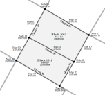
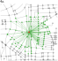
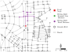
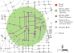

::: {.content-visible unless-format="revealjs"}

<center class='mb-3'>
<a class="h2" href="./slides.html" target="_blank">Open slides in new tab &rarr;</a>
</center>

:::


## Final Project Details {.crunch-title data-name="Final Projects"}

* **Project Showcase**: 6:30-9pm, Wed, **December 2**, 2026
  * Come eat falafel and show off your cool visualizations and regression coefficients!
* **Reports**: Due 5:59pm, Fri, **December 11**, 2026
  * If you're in DSAN 6000 and you're worried about that final project... See **calendar!** (In two slides)

<!-- {fig-align="center"} -->

::: {.hidden}

```{r}
#| label: r-source-globals
source("../dsan-globals/_globals.r")
source("../dsan-globals/_globals-sf.r")
```

:::

## Research Methodology: Hypotheses {.crunch-title .crunch-img}

<center>
**Social Science (McCourt):**

{width="40%"}
</center>

<center>
**Machine Learning (DSAN):**

{width="40%"}
</center>

## Due Date Details {.smaller .crunch-title .title-12}

<center>

<iframe src="https://calendar.google.com/calendar/embed?height=550&wkst=1&ctz=America%2FNew_York&showPrint=0&src=Y19iMmNhM2I5NTM5MWY1OTk2Zjc0Y2FjMDQ5ZGE1MjZhZDY0YWIwOThmOTc3ZjIwZjQ1YTBiYTVjN2IwMmMxZWIyQGdyb3VwLmNhbGVuZGFyLmdvb2dsZS5jb20&color=%239e69af" style="border:solid 1px #777" width="100%" height="550" frameborder="0" scrolling="no"></iframe>

</center>

## Visualizing Spatial Data {.smaller .crunch-title .title-12 .crunch-ul data-name="Leaflet"}

```{=html}
<style>
.highlight-icon {
  color: #e69f00;
}
</style>
```

* My recommendation for final presentations: Tiptoe from **`mapview`** $\leadsto$ **Leaflet!**

```{r}
#| label: midwest-pop-plot
#| echo: true
#| output-location: column
library(leaflet) |> suppressPackageStartupMessages()
library(leaflet.extras2) |> suppressPackageStartupMessages()
library(mapview) |> suppressPackageStartupMessages()
set.seed(6805)
city_df <- tibble::tribble(
  ~city, ~lon, ~lat, ~pop,
  "Chicago", 41.950567516553896, -87.93011127491978, 2746388,
  "Detroit", 42.45123004999075, -83.18402319217698, 631524
)
city_sf <- sf::st_as_sf(
  city_df,
  coords = c("lat", "lon"),
  # Reminder: CRS 4326 is more *efficient* for web
  # display (uses less memory on average);
  # CRS 3857 is less efficient (uses more memory
  # on average), since it includes info necessary
  # for precise *distance* calculations (hence
  # spatstat's 3857 requirement for ppp objects)
  crs=4326
)
city_buf_sf <- city_sf |> sf::st_buffer(20000)
city_cases_sf <- city_buf_sf |>
  sf::st_sample(size=rep(10,2)) |>
  sf::st_as_sf()
city_cases_sf$city <- "Detroit (10 Cases)"
city_cases_sf[1:10, 'city'] <- "Chicago (10 Cases)"
city_cases_sf$sample <- "Flu"
# Now sample from *population* to visualize
# *base rates*
city_pop_sf <- city_buf_sf |>
  sf::st_sample(size=c(16, 4)) |>
  sf::st_as_sf()
city_pop_sf$city <- "Detroit"
city_pop_sf[1:16, 'city'] <- "Chicago"
city_pop_sf$sample <- "People"
# Uncomment for "plain" mapview output (compare!)
# city_combined_sf <- bind_rows(
#   city_cases_sf,
#   city_pop_sf
# )
# mapview(
#   city_combined_sf, zcol="city", marker="sample"
# )
# Custom icon from *local* image for flu cases
Flu = makeIcon(
    iconUrl="images/Maki2-danger-24.svg",
    iconRetinaUrl="images/Maki2-danger-24.svg",
    iconWidth=20,
    iconHeight=20,
    className='highlight-icon'
)
# Custom icon from *web* image for base rates
People = makeIcon(
  iconUrl="https://upload.wikimedia.org/wikipedia/commons/e/ef/Maki2-pitch-24.svg",
  iconRetinaUrl="https://upload.wikimedia.org/wikipedia/commons/e/ef/Maki2-pitch-24.svg",
  iconWidth=20,
  iconHeight=20
)
leaflet(city_cases_sf) |>
  addProviderTiles("Esri.WorldGrayCanvas") |>
  # addProviderTiles("CartoDB.Positron") |>
  addMarkers(data=city_cases_sf, icon = Flu) |>
  addMarkers(data=city_pop_sf, icon = People) |>
  addControl(
    html_legend(
      urls   = c("https://raw.githubusercontent.com/jpowerj/dsan-content/refs/heads/main/2026-fall-ppol6805/Maki2-danger-24.svg", "https://upload.wikimedia.org/wikipedia/commons/e/ef/Maki2-pitch-24.svg"),
      labels = c("Flu", "At Risk"),
      title  = "Status"
    ),
    position = "bottomright"
  ) |>
  addControl(
    html_label("Chicago<br>Population 2.7 million"),
    position = "topleft"
  ) |>
  addControl(
    html_label("Detroit, MI<br>Population 650,000"),
    position = "topright"
  )
```

## You've Secretly Been Using Leaflet All Along! {.smaller .crunch-title .crunch-quarto-figure .title-10 .leaflet-350}

```{r}
#| label: mapview-leaflet-setup
#| code-fold: true
#| code-summary: "Setup Code"
library(tidyverse) |> suppressPackageStartupMessages()
library(sf) |> suppressPackageStartupMessages()
library(osmdata) |> suppressPackageStartupMessages()
library(mapview) |> suppressPackageStartupMessages()
get_osm_cached <- function(query, cache_file, tries = 3) {
  if (file.exists(cache_file)) {
    message("Loading cached data from ", cache_file)
    return(readRDS(cache_file))
  }
  for (i in seq_len(tries)) {
    result <- tryCatch(
      osmdata_sf(query),
      error = function(e) {
        message("Attempt ", i, " failed: ", conditionMessage(e))
        NULL
      }
    )
    if (!is.null(result)) {
      saveRDS(result, cache_file)
      message("Saved to ", cache_file)
      return(result)
    }
    Sys.sleep(5)
  }
  stop("Failed to fetch after ", tries, " attempts.")
}
nh_bbox <- getbb("New Haven, CT")
highway_result <- opq(bbox=nh_bbox) |>
  add_osm_feature(
    key = "highway",
    value = "motorway"
  )
transport_result <- opq(bbox=nh_bbox) |>
  add_osm_feature(
    key="public_transport"
  )
nh_road_sfs <- get_osm_cached(highway_result, "data/nh_road_sfs.rds")
nh_transport_sfs <- get_osm_cached(transport_result, "data/nh_transport_sfs.rds")
nh_road_sf <- nh_road_sfs$osm_lines
```

:::: {.columns style="display: flex; align-items: flex-end;"}
::: {.column width="50%"}

```{r}
#| label: mapview-basic
#| code-fold: show
mapview(nh_road_sf)
```

:::
::: {.column width="50%"}

```{r}
#| label: leaflet-basic
#| code-fold: show
leaflet() |>
  leaflet::addProviderTiles("Esri.WorldGrayCanvas") |>
  leaflet::addPolylines(
    data=nh_road_sf, weight=2
  )
```

:::
::::

## Putting Things Into Leaflet

* <i class='bi bi-1-circle'></i> Let's go take a look at the [**Getting GIS Data** writeup!](../writeups/data-sources/index.qmd)
* <i class='bi bi-2-circle'></i> Constructing "Overpass Queries":
  * [`getbb()`](https://docs.ropensci.org/osmdata/reference/getbb.html)
  * [Map features](https://wiki.openstreetmap.org/wiki/Map_features)

## Application: Urban Segregation {.smaller .crunch-img data-name="Urban GIS"}

Step <i class='bi bi-1-circle' style='font-size: 90%;'></i>: [Mapping Inequality](https://dsl.richmond.edu/panorama/redlining/)

:::: {.columns}
::: {.column width="50%"}

<center>

```{=html}
<iframe src="https://dsl.richmond.edu/panorama/redlining/" width="100%" height="450"></iframe>
```

</center>

:::
::: {.column width="50%"}

<center>

{fig-align="center" width="320"}

</center>

:::
::::

## Spatial *Data Science* {.smaller .crunch-title .crunch-img}

Step <i class='bi bi-2-circle'></i> Quantifying and evaluating **hypotheses** about urban segregation

{fig-align="center" width="80%"}

## Straight-Line vs. Street Distance

:::: {layout="[1,1]"}

{fig-align="center"}

{fig-align="center"}

::::

## ...Evaluating Impacts of Policy Interventions! {.smaller .crunch-title .title-11 .crunch-img}

{fig-align="center"}

## Custom Bounding Box {.smaller}

```{r}
#| label: new-haven-custom
#| output-location: column
custom_upper_left <- c(41.362432360113566, -72.9722636671877)
custom_lower_right <- c(41.34295668062255, -72.9385289699316)
bbox_coords <- c(
  custom_upper_left[2],
  custom_upper_left[1],
  custom_lower_right[2],
  custom_lower_right[1]
)
names(bbox_coords) = c("xmin","ymin","xmax","ymax")
custom_sf <- st_as_sf(
  st_as_sfc(
    st_bbox(bbox_coords)
  ),
  crs=4326
)
# nh_query <- opq(bbox=bbox_coords) |>
#   add_osm_feature(
#     key = "highway"
#   )
# nh_sfs <- osmdata_sf(nh_query)
# nh_road_sf <- nh_sfs$osm_lines
# mapview(nh_road_sf)
mapview(custom_sf)
```

## References

::: {#refs}
:::
